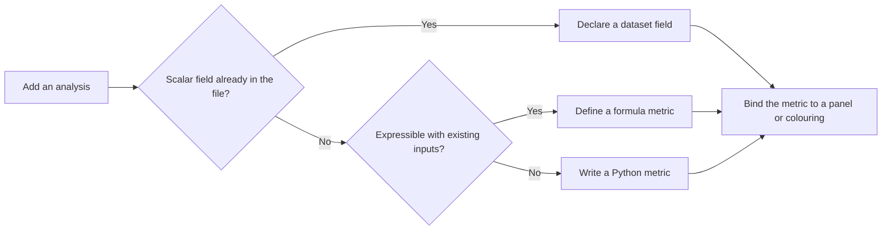

# Contributing

Thanks for looking. Bug reports and small fixes are the most useful things you
can send. For anything larger, open an issue first so we can agree on the shape
before you write code.

## Setting up

FFAST currently requires Python 3.11; see `requires-python` in `pyproject.toml`.

```bash
git clone https://github.com/TCPUniLU/FFAST.git
cd FFAST
python3.11 -m venv .venv && source .venv/bin/activate
python -m pip install -e ".[dev]"      # browser client, server, CLI and test tools
python -m playwright install chromium  # browser used by the browser tests
```

On Linux, `python -m playwright install --with-deps chromium` also installs the
system libraries Chromium needs (this is what CI runs).

Put the virtualenv somewhere that is not synced by iCloud or Dropbox. A synced
directory can rewrite environment files while tests are running.

## Running the tests

```bash
pytest -m "not integration"   # skip integration tests
pytest                        # adds tests that spawn a real ffast-server
```

Tests run in six parallel processes by default (pytest-xdist, in the `dev`
extra; set by `addopts` in `pyproject.toml`). Each browser test starts its own
server on free ports, so they do not collide; the browser tests take about 3
minutes instead of 9. Add `-n 0` to run in one process, for example when
debugging with `pdb` or reading `print` output.

Some tests need optional dependencies. See the
[legacy test requirements](#legacy-qt-desktop-tests) for the remaining Qt tests.

Two extra checks are worth running before you push, because CI runs them:

```bash
ffast-cli metrics validate    # freezes the metric graph, reports bad refs/shapes/cycles
ffast-cli metrics test        # runs the metrics' own declared test cases
```

## Style

- `black` and `isort`, both at line length 79. Config is in `pyproject.toml`.
- No new imports of PySide6, pyqtgraph or vispy from inside `ffast/`. That
  package has to stay importable on a compute node with no display, and
  `tests/ffast/test_ffast_core_boundary.py` will fail if you break it.
- Metrics must be picklable and deterministic. They run in a separate worker
  process, so no closures, no lambdas, no global mutation.

## A good place to start

The browser client is the main interface and the target for new UI features.
Its plain JavaScript modules live in `ffast/renderers/web/static/`; edit a file
and reload the browser, with no build step. The Python server handles data and
scientific calculations.

For a UI fix, reproduce the issue in the browser and add a focused runtime test
where useful. See the [usage guide](docs/usage.md) for the supported workflows.

## Adding things

Before writing Python, check whether the declarative route covers you. New
metrics, plots and whole analysis tabs can be added from a project `ffast.toml`
with no code at all. See [docs/usage.md](docs/custom-metrics.md).



For code changes, [CONTEXT.md](CONTEXT.md) defines the vocabulary the codebase
uses (Environment, Metric, Panel, Scene, and so on). Using those words in your
PR saves everyone a round trip.

## Design decisions

Anything that changes a seam between components gets an ADR in
[docs/adr/](docs/adr/): what the problem was, what we picked, what we gave up.
Copy the shape of a recent one, number it next in sequence, and link it from the
PR. See [docs/adr/README.md](docs/adr/README.md) for the index.

## Pull requests

- Branch off `dev`.
- One logical change per PR.
- Say how you tested it. "Ran the suite" is fine for refactors; anything
  touching the UI needs a note on what you clicked and what you saw.

## Legacy Qt desktop tests

The desktop client is being retired and is planned for removal. Work on current
UI features in the browser. To run the remaining Qt-dependent tests, install
`python -m pip install -e ".[gui,dev]"` and provide a display, or set
`QT_QPA_PLATFORM=offscreen`. The legacy client starts with `ffast-qt`.
