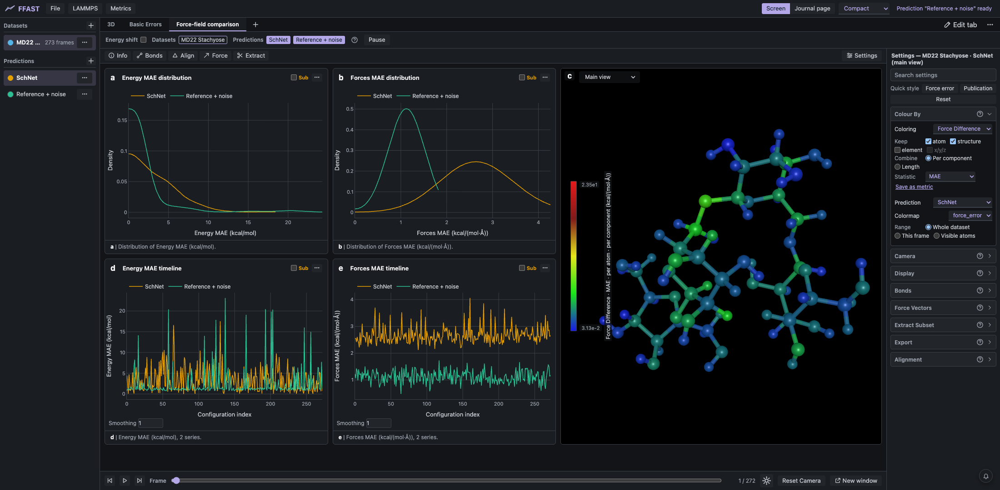

# FFAST

[](https://github.com/TCPUniLU/FFAST/actions/workflows/tests.yml)
[](pyproject.toml)
[](LICENSE)

**Force Field Analysis and Screening Tool** — compare machine-learned force
fields, inspect the structures where they fail, and monitor molecular dynamics.

Load reference data and predictions to compare energy and force errors. Click
an outlier to inspect its geometry and force vectors in 3D. For live LAMMPS
runs, FFAST uses DetectAna to flag structures that depart from a fitted reference
and can stop the simulation on an alarm.

The interface runs in your browser. A Python server loads data and computes
analyses on your computer or a SLURM compute node. For cluster sessions, the
trajectory stays on the cluster, and the analysis results and the structures you inspect
are sent to your browser.



*A custom comparison tab using bundled MD22 data. Reference + noise is a
perturbed-reference control.*

| Guide | Contents |
| --- | --- |
| [Installation](docs/installation.md) | uv, pip, optional dependencies and launch options |
| [Using FFAST](docs/usage.md) | Data, plots, 3D views, subsets and sessions |
| [Custom metrics and tabs](docs/custom-metrics.md) | Formulas, dataset fields, panels and Python metrics |
| [LAMMPS](docs/lammps.md) | Reference fitting, monitored jobs, alarms and stopping |
| [Cluster setup](docs/clusters.md) | SSH/SLURM profiles, remote servers and reconnecting |
| [Development](CONTRIBUTING.md) | Setup, tests and contributing |

The [documentation index](docs/README.md) also links architecture and design records.

## Install

FFAST currently requires **Python 3.11**. From a source checkout, using
[uv](https://docs.astral.sh/uv/getting-started/installation/):

```bash
git clone https://github.com/TCPUniLU/FFAST.git
cd FFAST
uv venv --python 3.11
source .venv/bin/activate
uv pip install -e .
ffast-cli metrics list
ffast
```

uv installs Python 3.11 if needed, independently of your system Python.
For pip, Windows activation and optional dependencies, see
[Installation](docs/installation.md). The base install includes the browser
client, server and CLI; it needs no native Qt or OpenGL libraries.

## Quick start

1. Choose **File → Load Example Dataset and Prediction** for the bundled SPICE
   pair, or **File → Tour: First steps** for a guided introduction.
2. Open **Basic Errors**. Select datasets and predictions in the tab's selector;
   select several predictions to compare them.
3. Click a timeline point to inspect its configuration in 3D. Show force vectors
   or colour atoms by force error.
4. Zoom a plot and enable **Sub** to analyse the configurations in that region.
5. **Save Session** retains loaded objects, settings and cached results. Keep
   the original data files available: sessions store their paths.

For your own files, use **File → Load Dataset** and **Load Prediction**, or the
`+` buttons in the left rail. FFAST reads sGDML `.npz` datasets and ASE formats
such as `.extxyz`, `.traj` and `.db`, including periodic and variable-sized
structures. Predictions can be `.npz` files with `E` and `F`, or ASE-readable
files carrying energies and forces.

Check the selected fields and units: unit labels do not convert values. See the
[example data guide](examples/data/README.md) for MD22, SPICE and MPtrj sources
and units. `examples/MACE/` and `examples/Nequip/` contain saved sessions.

## Analysis

- **Errors:** energy and force MAE/RMSE, timelines, distributions, scatter,
  per-element breakdowns and net force residuals. An energy-shift control removes
  a constant prediction offset.
- **3D:** metric colouring, force vectors, bonds, unit cells, measurements,
  alignment, playback and PNG export. Use independent panels to compare structures.
- **Custom metrics and tabs:** write and try formulas in **Metrics**, or define
  file fields, metrics and layouts in `ffast.toml`. Add templates with
  **+ → From template**, or build a tab in Edit mode.
- **Batch work:** use `ffast-cli` for metric inspection, validation and
  calculation. The [headless example](examples/headless/headless.py) shows a
  Python workflow that saves a session for later viewing.

## Live LAMMPS runs

After [installing the live dependencies](docs/lammps.md#installation), try
**LAMMPS → Tour: Watch a LAMMPS run**. It replays bundled geometry through the
real scorer and needs no LAMMPS installation.

For your own run, use **Make Reference…**, then **Run with FFAST…** to check,
review and submit copies of a SLURM input and job script. **Live Runs…** opens
running or completed runs. The [LAMMPS guide](docs/lammps.md) also covers manual
setup, scores, attribution and stop controls.

Live scoring supports **one molecule with fixed atom order, no periodic-boundary
handling, and LAMMPS `metal` or `real` units**. Scores measure structural
departure from the reference. Stopping is off by default; a multi-process stop
terminates the launch, and FFAST writes no checkpoint.

**Atom order unverified** means the starting geometry lacks a matching local
record proving reference order. A passing bond check does not establish that
proof. See [atom identity](docs/lammps.md#atom-identity), including how to generate
verified starting data.

## Status

This is the version 2 development tree; install from source. The browser is the
main client. Precomputed predictions are the main model-comparison workflow;
trained-model inference requires its backend and remains less polished. Browser
submission of LAMMPS jobs uses SLURM; local runs use the command-line wrapper.

For implementation details, see the [architecture](docs/architecture.md),
[domain vocabulary](CONTEXT.md) and [design decisions](docs/adr/README.md).

## Credits and history

FFAST was created in 2022 by **Gregory Fonseca**, with Igor Poltavsky and
Alexandre Tkatchenko, in the Theoretical Chemical Physics group at the
University of Luxembourg. That work is what the JCTC paper below describes; the
code released with the paper has its own repository. This one is where
development carried on afterwards.

The version 2 rewrite is by **Anton Charkin-Gorbulin**, who took the codebase
over in 2024, with Igor Poltavsky: the client/server split and the headless
core, the browser client that replaced the Qt desktop, remote execution on SLURM
clusters with self-installing servers, the config-driven metric and plotting
system, and the fingerprint-keyed cache.

**Amirarsalan Sanati** contributed the large-dataset handling that makes FFAST
usable on real trajectories — `AtomsList`, ASE-trajectory loading, sampling and
caching — plus the example data corpus and a long run of bug fixes.

`git shortlog -sn` has the exact split.

## Citation

If you use FFAST in published work, cite the original paper. It describes the
tool and the analysis approach, not this rewrite:

```bibtex
@article{fonseca2023ffast,
  title={Force Field Analysis Software and Tools (FFAST): Assessing Machine
         Learning Force Fields under the Microscope},
  author={Fonseca, Gregory and Poltavsky, Igor and Tkatchenko, Alexandre},
  journal={Journal of Chemical Theory and Computation},
  volume={19}, number={23}, pages={8706--8717}, year={2023},
  publisher={American Chemical Society},
  doi={10.1021/acs.jctc.3c00985}
}
```

Built on ASE, PyTorch, Three.js, Plotly, vispy and pyqtgraph. Test data from the
MD22 collection by Stefan Chmiela and co-workers.

## Contributing

Bug reports and small fixes welcome; open an issue first for anything larger. See
[CONTRIBUTING.md](CONTRIBUTING.md).

## License

MIT. See [LICENSE](LICENSE).

## Legacy desktop client

`ffast-qt` is being retired and is planned for removal. Existing users can find
[legacy instructions](docs/legacy-qt.md) at the end of the usage guide.
