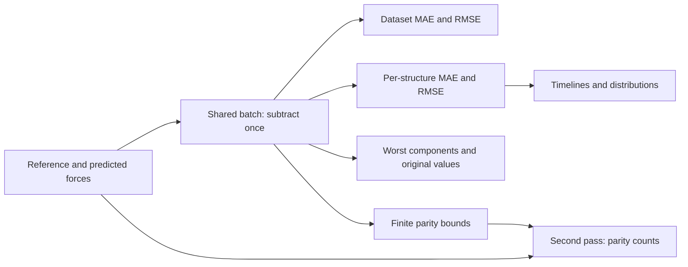

# Related force metrics share batched passes

Status: Accepted and implemented 2026-11-15. Extends ADRs 0085 and 0102;
uses the loading/cache changes in ADR 0103.

## Problem

Basic Errors requests fourteen outputs, many needing the same predicted minus
reference forces. The result cache already shared the base dependency, but in
memory-saving mode that dependency was a lazy recipe. Each consumer evaluated
it again. A six-result regression test read each input ten times. Outliers
also reread selected force values after finding their indices.

The user requested a shared batch arrangement. Keeping the complete difference
would consume another 1.79 GiB for the reported dataset. Caching that difference
alone would still leave independent statistics and outlier scans over it.

## Decision

Add an optional server-executor optimization for the canonical full-dataset
force MAE/RMSE family. Keep ordinary metric IDs, dependency plans, result keys,
units, shapes and protocol replies. Metric functions remain pure functions of
arrays; shared state belongs to the executor.

The first pass reads each reference/prediction batch once and calculates
`predicted - reference` once. Complete frames stay together. The same values
feed dataset MAE/RMSE, per-structure MAE/RMSE, worst-component selection and
finite parity bounds. Keep the selected outliers' original true/predicted
values during selection, avoiding scattered rereads after the scan.

If parity density is requested, count it in a second pass using the shared
bounds. This pass performs no force subtraction. Smoothing and error
distributions use the retained per-structure series, with their existing
algorithms and parameters, rather than reevaluating forces.

Recognize only the exact canonical component-MAE/RMSE expressions, their
unaltered base function and the built-in force parity functions. Require
named inputs, matching float64 `(atoms, 3)` arrays and consistent offsets.
Unidentified/subset sources, other dtypes, custom formulas and other box
settings keep their existing execution paths. A shared scan is an optimization,
not a new interpretation of arbitrary expressions.

The shared key includes reference/prediction identities, shape, offsets identity
and registry revision. Concurrent requests register their interest before
execution. One caller produces a phase; the others wait without reserving
additional arithmetic workspaces. Cancellation of one caller does not cancel
other interested callers. When everyone leaves, the producer stops between
batches. Partial results are not published; a later request can retry.

Batch reads and arithmetic overlap on the server's existing chunk pool. Admit
up to four in-flight batches, limited further by available CPUs and shared RAM
headroom. Each lane reads a reference/prediction pair and immediately reduces
it; while it calculates, other lanes can fetch later pairs. Do not enqueue the
whole dataset. Reserve ten arithmetic blocks per lane before dispatch, leaving
source-parser headroom. Merge partials in source order, with result-file writes
on the producing request thread. This preserves summation order and bounded
top-k tie handling even when batches finish out of order.

Carry cancellation and profiling context into worker threads. On failure or
cancellation, cancel queued work and join in-flight batches before releasing
the workspace or aborting output writers. Small budgets and single-CPU jobs
use the same kernel synchronously without a thread-pool hop. Four is a measured
default: on the same full-file parsed cache, serial took 52.54 seconds, four
lanes 27.22 seconds, and six lanes 29.64 seconds. More worker threads did not
improve this workload further. The private lane selector accepts a higher cap
for controlled profiling; normal operation uses four.

All allocations use the shared budget. Keep small per-structure series in RAM;
large ones own bounded result files through the existing result writer. This
preserves downstream streaming KDE/smoothing. Never retain the full difference.
At most two idle summaries are kept. They are evictable under memory pressure
and discarded on object/result invalidation or shutdown. If the extra shared
outputs cannot be admitted, fall back to individual streaming kernels so a
valid scalar request remains usable.

## Alternatives and costs

- **Only rename/group the task rows:** improves presentation but saves no
  reads or arithmetic. Rows continue to represent requested metric results;
  several now wait on one shared producer.
- **Materialize the full difference:** simple reuse but another large result
  allocation/write, and parity still needs both original force arrays.
- **Automatically fuse every formula graph:** broader coverage, but a new
  compiler/scheduler with masking, grouping and lifecycle rules. The canonical
  family is a small, independently verifiable first step.

A lone compatible request can calculate additional related summaries. Their
bounded storage/compute cost is accepted to make concurrent and later requests
share the pass; allocation failure preserves the old path. The specialized
kernel must be updated if the canonical definitions change. Recognition and
differential tests guard against silently replacing custom definitions.

Floating-point summation order can differ, so equivalence is tested at tight
float64 tolerances rather than bitwise equality. Empty structures retain NaN
as no-value gaps; bad non-finite inputs still fail the relevant reductions.
Parity/outliers preserve their finite-value rules. Equal-error top-k ties can
choose different equally ranked components when batch boundaries differ,
as the previous bounded algorithm already could.

## Validation

Tests compare concurrent summaries, parity/outlier results and downstream
timelines/distributions with the existing engines. Counting input reads proves
exactly two passes when all compatible outputs are requested, and exactly one
pass for summaries without parity density. Tests cover variable/empty frames,
non-finite values and overflow, custom formulas, cancellation with surviving
waiters, retry after cancellation, invalidation, spill and admission fallback.
Parallel coverage repeats the differential/read-count checks with different
CPU availability and small batches. Barriers prove actual overlap; injected
read failures and worker cancellation prove bounded dispatch, draining before
workspace release, and successful retry without partial result publication.

On the complete SO3LR file (3,856,645 frames, 80,227,586 atoms), each new server
recorded one 230-batch summary pass and one histogram pass. All fourteen Basic
Errors outputs succeeded. The first calculation measured 37.52 seconds versus
47.78 seconds in the preceding verified profile; reopen measured 36.98 seconds.
The strict sixty-second load/metric check passed both runs. See the
[profiling report](../reports/2026-11-15-so3lr-laptop-profile.md) for conditions,
resource measurements and artifacts.
