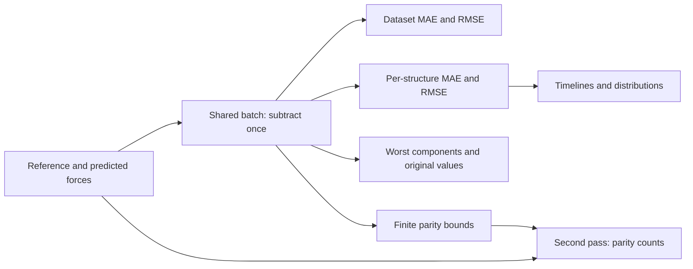

# Related force metrics share batched passes

Status: Accepted and implemented 2026-11-15. Extends ADRs 0085 and 0102;
uses the loading/cache changes in ADR 0103.

## Problem

Basic Errors requests fourteen outputs, many needing the same predicted minus
reference forces. The result cache already shared the base dependency, but in
memory-saving mode that dependency was a lazy recipe. Each consumer evaluated
it again. A six-result regression test read each input ten times. Outliers
also reread selected force values after finding their indices.

The user requested a shared batch arrangement. Keeping the complete difference
would consume another 1.79 GiB for the reported dataset. Caching that difference
alone would still leave independent statistics and outlier scans over it.

## Decision

Add an optional server-executor optimization for the canonical full-dataset
force MAE/RMSE family. Keep ordinary metric IDs, dependency plans, result keys,
units, shapes and protocol replies. Metric functions remain pure functions of
arrays; shared state belongs to the executor.

The first pass reads each reference/prediction batch once and calculates
`predicted - reference` once. Complete frames stay together. The same values
feed dataset MAE/RMSE, per-structure MAE/RMSE, worst-component selection and
finite parity bounds. Keep the selected outliers' original true/predicted
values during selection, avoiding scattered rereads after the scan.

If parity density is requested, count it in a second pass using the shared
bounds. This pass performs no force subtraction. Smoothing and error
distributions use the retained per-structure series, with their existing
algorithms and parameters, rather than reevaluating forces.

Recognize only the exact canonical component-MAE/RMSE expressions, their
unaltered base function and the built-in force parity functions. Require
named inputs, matching float64 `(atoms, 3)` arrays and consistent offsets.
Unidentified/subset sources, other dtypes, custom formulas and other box
settings keep their existing execution paths. A shared scan is an optimization,
not a new interpretation of arbitrary expressions.

The shared key includes reference/prediction identities, shape, offsets identity
and registry revision. Concurrent requests register their interest before
execution. One caller produces a phase; the others wait without reserving
additional arithmetic workspaces. Cancellation of one caller does not cancel
other interested callers. When everyone leaves, the producer stops between
batches. Partial results are not published; a later request can retry.

Batch reads and arithmetic overlap on the server's existing chunk pool. Admit
up to four in-flight batches, limited further by available CPUs and shared RAM
headroom. Each lane reads a reference/prediction pair and immediately reduces
it; while it calculates, other lanes can fetch later pairs. Do not enqueue the
whole dataset. Reserve ten arithmetic blocks per lane before dispatch, leaving
source-parser headroom. Merge partials in source order, with result-file writes
on the producing request thread. This preserves summation order and bounded
top-k tie handling even when batches finish out of order.

Carry cancellation and profiling context into worker threads. On failure or
cancellation, cancel queued work and join in-flight batches before releasing
the workspace or aborting output writers. Small budgets and single-CPU jobs
use the same kernel synchronously without a thread-pool hop. Four is a measured
default: on the same full-file parsed cache, serial took 52.54 seconds, four
lanes 27.22 seconds, and six lanes 29.64 seconds. More worker threads did not
improve this workload further. The private lane selector accepts a higher cap
for controlled profiling; normal operation uses four.

All allocations use the shared budget. Keep small per-structure series in RAM;
large ones own bounded result files through the existing result writer. This
preserves downstream streaming KDE/smoothing. Never retain the full difference.
At most two idle summaries are kept. They are evictable under memory pressure
and discarded on object/result invalidation or shutdown. If the extra shared
outputs cannot be admitted, fall back to individual streaming kernels so a
valid scalar request remains usable.

## Alternatives and costs

- **Only rename/group the task rows:** improves presentation but saves no
  reads or arithmetic. Rows continue to represent requested metric results;
  several now wait on one shared producer.
- **Materialize the full difference:** simple reuse but another large result
  allocation/write, and parity still needs both original force arrays.
- **Automatically fuse every formula graph:** broader coverage, but a new
  compiler/scheduler with masking, grouping and lifecycle rules. The canonical
  family is a small, independently verifiable first step.

A lone compatible request can calculate additional related summaries. Their
bounded storage/compute cost is accepted to make concurrent and later requests
share the pass; allocation failure preserves the old path. The specialized
kernel must be updated if the canonical definitions change. Recognition and
differential tests guard against silently replacing custom definitions.

Floating-point summation order can differ, so equivalence is tested at tight
float64 tolerances rather than bitwise equality. Empty structures retain NaN
as no-value gaps; bad non-finite inputs still fail the relevant reductions.
Parity/outliers preserve their finite-value rules. Equal-error top-k ties can
choose different equally ranked components when batch boundaries differ,
as the previous bounded algorithm already could.

## Validation

Tests compare concurrent summaries, parity/outlier results and downstream
timelines/distributions with the existing engines. Counting input reads proves
exactly two passes when all compatible outputs are requested, and exactly one
pass for summaries without parity density. Tests cover variable/empty frames,
non-finite values and overflow, custom formulas, cancellation with surviving
waiters, retry after cancellation, invalidation, spill and admission fallback.
Parallel coverage repeats the differential/read-count checks with different
CPU availability and small batches. Barriers prove actual overlap; injected
read failures and worker cancellation prove bounded dispatch, draining before
workspace release, and successful retry without partial result publication.

On the complete SO3LR file (3,856,645 frames, 80,227,586 atoms), each new server
recorded one 230-batch summary pass and one histogram pass. All fourteen Basic
Errors outputs succeeded. The first calculation measured 37.52 seconds versus
47.78 seconds in the preceding verified profile; reopen measured 36.98 seconds.
The strict sixty-second load/metric check passed both runs. See the
[profiling report](../reports/2026-11-15-so3lr-laptop-profile.md) for conditions,
resource measurements and artifacts.

## Amendment 2026-11-20: the summary pass keeps per-atom colour ranges

3D colouring by a per-atom force error (`force_difference[atom+structure;component;mae]`,
`[...;component;rmse]` and `[atom+structure;length]`, exact built-in formulas
only) needs only the lowest and highest value over every atom. The summary
pass already computes each atom's error, so it now keeps those three ranges
(six numbers). `run_colouring` asks `ForceScans.colour_range` first; when a
summary for the same forces is stored, the colour range costs no read.
An atom whose error is not finite leaves the ranges out, so the colour pass
then runs as before and keeps its own rules for such values.

Colouring first does not run the summary pass: with a memory budget of 512 MB
or less the summary pass gets one core and took 9.1-9.7 s on a 10 GB file
(370,344 frames, 94.8M atoms), against 2.7-3.1 s for the colour pass alone.
With a 14 GB budget it used about 4 cores and took 2.5 s.

Instead, colouring by per-atom MAE (only that one) sums each structure's MAE
and the dataset MAE from the values it reads anyway (`FrameMAE`). When it
finishes, they are kept beside the group's summary (`from_colour`), and the
shared pass answers `[structure;component;mae]` and `[dataset;component;mae]`
from them until a summary exists. The MAE table cell, distribution and
timeline then need no read; RMSE, outliers and the parity density still run
the pass. Nothing is kept when the colouring stops or fails, when a structure
with atoms has no finite value, or when the per-structure values would be
larger than the summary pass keeps in memory (it writes those to result
files). Sums run in a different order than the summary pass, so values may
differ in the last bits (tests compare to 1e-12).

On the 10 GB file, colouring first then took 2.7-3.4 s (before 2.7-3.1 s);
the four MAE outputs after it 0.09-0.13 s; the remaining Basic Errors force
pass 2.7 s with 4 cores (14 GB) and 8.9-9.6 s (512 MB), as without colouring.

Measured on that file (laptop, parsed cache warm): colouring after Basic
Errors went from 2.7-2.9 s to 2 ms with the same range; the summary pass took
2.6-2.9 s (14 GB budget) and 9.2-9.7 s (512 MB), within run-to-run spread of
before. A summary is kept for at most two idle force pairs and may be evicted;
then the colour pass reads the forces again. Forces given as plain in-memory
arrays (not batched) never make a summary, so they gain nothing.

## Amendment 2026-11-21: the summary pass also does the Atomic Errors work

The Atomic Errors tab reads the same forces as Basic Errors: the per-element
MAE and RMSE table (`force_difference[element;component;mae]` and
`[...;rmse]`, exact built-in formulas only) and the per-element MAE
distribution (`force_mae_per_structure_per_element_kde`). Each made its own
pass, about 85 s on an 83 GB extxyz file whose forces are not in the parsed
cache (7.09M structures, 463M atoms, 10 elements).

The summary pass now also reads every atom's element, a batch at a time, and
keeps:

- per element, the sums of each atom's MAE and MSE and the atom count (three
  numbers per element), which give the table;
- each structure's MAE over its atoms of each element, one column per
  element (NaN where a structure has none), which gives the distribution.
  Small tables stay in memory; larger ones go to result files, 8 bytes per
  structure and element (541 MB for the file above).

Either tab first now runs the one pass for both. The elements are part of
the group's key by their name; elements without a name are left out of the
pass. The table of each structure is not kept above 32 elements (a batch's
table would outgrow its workspace) or when result storage refuses it; the
distribution then makes its own pass as before. An atom whose element is not
in the dataset's list drops the per-element work for that pass.

Cost, measured with a prototype of the same arithmetic on the 83 GB file:
14 GB budget 59-63 s before, 61-63 s after (CPU 420 -> 449 s, +7%); 512 MB
budget 375 s -> 395 s (+5%). The per-element sums run in another order than
the formula's, so values may differ in the last bits (tests compare to 1e-9
for the distribution, 1e-12 for the rest).

## Amendment 2026-11-21 (later): Subsystem Errors and colouring by element error

**Subsystem Errors.** Its three metrics (`force_net_residual[structure;component;mae]`,
`[dataset;component;mae]` and `[dataset;component;rmse]`) each read every
force again, even right after Basic Errors: each runs `force_net_residual`
(each structure's sum of its atoms' errors) as a value read on demand. The
summary pass now also keeps that sum, three numbers per structure, with the
same arithmetic as `force_net_residual`. The shared pass answers
`force_net_residual` from it, so these metrics after Basic Errors read no
forces, and Subsystem Errors first runs the one pass for both.

**Colouring by element error.** Colouring the 3D view by
`force_difference[element;component;mae]` or `[...;rmse]` takes the
per-element values of a finished summary (`ForceScans.element_values`) and
reads no forces. As for the per-atom ranges, a non-finite value leaves it to
the colour pass, and colouring first does not run the summary pass.

**Where kept values go.** The values kept for other tabs (each structure's
net force error and MAE per element) stay in RAM only up to 1/16 of a
memory block; larger ones go to result files, so they never take the RAM
the pass and the plots need. On the 83 GB file the net force errors take
170 MB of disk (7.09M structures x 3 x 8 bytes).

## Amendment 2026-11-21 (parity): the parity density is counted in the summary pass

The parity density bins every force component between the lowest and
highest value, known only after the whole pass; it took a second full pass.
On the 83 GB extxyz file (forces not in the parsed cache) that second pass
took 63 s of the 126 s Basic Errors cost.

The summary pass now counts each (true, predicted) pair on a fine
1200 x 1200 grid whose bins are a power of two wide at fixed places
(bin i holds [i w, (i + 1) w)). When values fall outside the grid, the width
doubles: bins 2i and 2i + 1 merge exactly, so no count is lost or moved.
Lanes bin on the merged grid's width when their values fit it, else on their
own, and the merging thread brings both to the wider one. The occupied span
stays between 600 and 1200 fine bins. At the end whole fine bins are added
into plot bins (`merge` = occupied span // 300 fine bins each), so every
count is exact, and only the plot's counts are kept.

**What changed in the plot:** the counts stay exact, but the bin edges are
fine-bin edges instead of the exact lowest and highest value. The plot
reaches past them by less than one plot bin, and has 300 to 599 bins per
axis instead of always 300 (the client reads the count from the bin
centres). A first version gave each fine bin to the plot bin holding its
centre, keeping 300 bins over [lowest, highest]; pairs near a plot edge
could then be counted one bin over. It was rejected for that inexactness.
Tests compare every bin with an exact count over the density's own edges.
Values too large to bin (a range that is not finite) and data with no
finite pair still use the second pass.

Measured on the 83 GB file (14 GB budget): the density after the pass
0.01 s (before 63.5 s); the summary pass 69.6 s (before 62.4 s; the fine
counts take 25 lane-seconds). Basic Errors in total: about 74 s, before 126 s.
