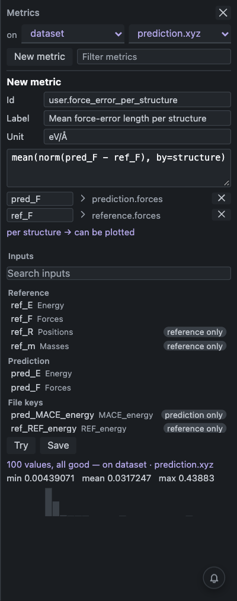
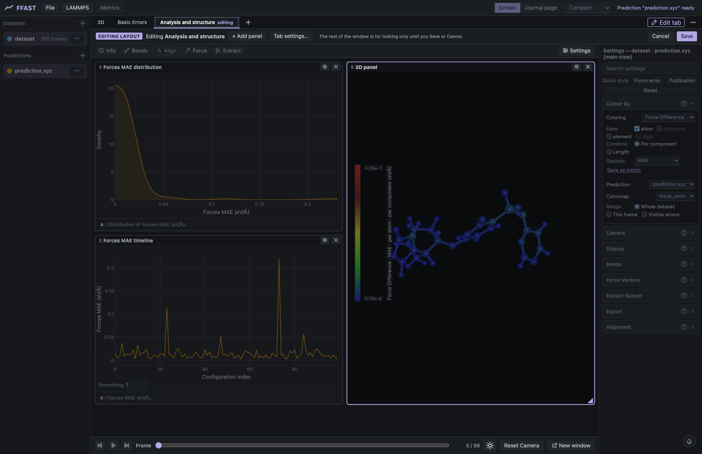

# Custom metrics and tabs

[README](../README.md) · [Documentation](README.md) · [Using FFAST](usage.md)

Three levels, and the first two need no Python at all. A project `ffast.toml`
overlays the defaults: an empty file changes nothing, named entries add or
override. It is found by searching upward from your data directory, or passed
explicitly. Unknown keys are an error rather than being ignored, which catches
typos.

## Dataset fields

Any numeric key in an extxyz file becomes a plottable metric:

```toml
[[metrics.fields]]
id    = "demo.total_charge"
ref   = "reference.info.total_charge"   # info.<key> is per-frame
label = "Total charge"
unit  = "dimensionless"
```

`ref` is `{reference,prediction}.{info,atoms}.<key>`. `info` keys give one value
per frame, `atoms` keys give one per atom. `ffast-cli dataset keys <file>` lists
what a given file offers. There is a working `ffast.toml` at the repo root.

## Formula metrics

A formula metric is arithmetic over named inputs, with no Python:

```toml
[[metrics.expr]]
id    = "mylab.force_error"
label = "Force error per atom"
unit  = "force"
expr  = "norm(pred_F - ref_F)"

  [metrics.expr.vars]
  pred_F = "prediction.forces"
  ref_F  = "reference.forces"
```

Each name in `expr` is bound in `vars` to an input: a metric id, a dataset
field, or a raw reference such as `reference.forces`. `n_atoms` is always
available (atoms per structure). Arithmetic works value by value; to combine
values, use a reduction (below).

What a formula may use:

- Arithmetic `+ - * / **`, unary `-`, the constant `pi`.
- Functions `abs sqrt exp log log10 sign clip where minimum maximum`.
- Comparisons `> < >= <= ==`, mostly inside `where(...)`:
  `where(abs(err) > 1, err, 0)`. A comparison gives 1 or 0.
- `norm(v)`: the length of a vector, taken over all its parts. For forces,
  `norm(pred_F - ref_F)` is the force error per atom.
- Named parts of a vector: `x(F)`, `y(F)`, `z(F)`.
- Positions: `F[2]` is the third part of a vector. Write whole numbers only,
  starting at 0. Use a position when no name covers the part you want.

- Reductions, which combine many values into one per group:
  `mean`, `sum`, `min`, `max`, `rms` (square, average, root) and `std` (divides
  by the number of values, like NumPy). Each needs `by=`, which says what to
  combine and so the shape of the result:

  | `by=` | combines | per-atom input gives | per-structure input gives |
  |---|---|---|---|
  | `structure` | the atoms of each structure | per structure | an error |
  | `element` | the atoms of each element | per element | an error |
  | `all` | everything | one number | one number |
  | `(structure, element)` | the atoms of each element in each structure | per structure and element | an error |
  | `atom` | the same atom in every structure | per atom of one structure | an error |

  `by=atom` needs every structure to have the same atoms in the same order;
  on any other dataset the metric fails and says so. In the browser, the
  check under the formula already warns when the dataset you have open is
  such a dataset; you can still save the formula for another one.

  A forgotten `by=` is an error, never a silent average over everything.
  `by=all` counts every atom once: the mean of the per-structure means is
  something else, written `mean(mean(err, by=structure), by=all)`. Per element,
  the elements are listed by atomic number. `min(a, b)` is an error: the smaller
  of two values at each place is `minimum(a, b)`.
- A reduction keeps the parts of a vector: `sum(pred_F - ref_F, by=structure)`
  is the net force error of each structure, a vector. `mean_parts(v)`,
  `sum_parts(v)` and `max_parts(v)` average, add or take the largest of the
  parts at each place, so the two usual force
  errors are `mean(norm(pred_F - ref_F), by=all)` (mean length of the error) and
  `mean(mean_parts(abs(pred_F - ref_F)), by=all)` (mean of all x, y, z errors).
- `by=(structure, element)` gives a table: one row per structure, one column per
  element of the dataset, in order of atomic number. A structure without that
  element has no value in that cell. It shows how the error of each element
  changes from frame to frame:

  ```
  mean(mean_parts(abs(pred_F - ref_F)), by=(structure, element))
  ```

  Write the pair in this order (`by=(element, structure)` is an error). A table
  combines with one number or with another table, but not with a per-structure
  or per-element value, and it cannot be reduced again yet.
- `element("H")` is 1 for each hydrogen atom and 0 for the others; it takes
  several symbols, `element("C", "N", "O")`, and "all but H" is
  `1 - element("H")`. These symbols are the only text a formula may hold.
- `where=` on a reduction picks the rows that count, and never changes the
  result's shape:

  ```
  mean(norm(pred_F - ref_F), by=structure, where=element("H"))   # H force error per structure
  rms(norm(pred_F - ref_F), by=all, where=element("C", "O"))     # one number for C and O
  mean(abs(pred_E - ref_E), by=all, where=n_atoms > 20)          # only large structures
  ```

Reductions nest and mix with arithmetic. One number spreads to any shape, so
`norm(dF) / max(norm(dF), by=all)` scales each atom's error to 0..1, and
`abs(dE - mean(dE, by=all))` removes the mean energy shift. A per-structure
value does not spread onto atoms: `err - mean(err, by=structure)` is an error.
A per-atom value does apply to each part of a per-atom vector, so
`(pred_F - ref_F) / m` divides each atom's x, y and z by its mass.

Any bad number (infinity, not-a-number) makes the whole metric fail on that
dataset, for example a division by zero. "No value" is different: a group with
nothing to combine, such as a structure without hydrogen under
`where=element("H")`. The metric still succeeds; that place shows as a gap in a
timeline, `—` in a table, a grey atom, and is left out of scatter plots and
densities. A later reduction leaves it out too. A bad value in a row that
`where=` leaves out does not fail the metric, since the formula never uses
it, but it is not passed over in silence: Try says "1 bad value in rows left
out by where= was ignored (frame 41)", and a panel drawing the metric shows ⚠
beside its title with the same sentence on hover. A formula that grows past
2,000 characters or 50 levels of nesting is refused.

**The position trap.** A position counts parts in the layout FFAST holds, not
the layout of your file. A vector has three parts, so `F[2]` is z. A stress
given in the six-number Voigt layout (xx, yy, zz, yz, xz, xy) has `S[1]` = yy,
while the same stress as a 3×3 table has `S[0,1]` = xy. The same position can
mean different things for inputs of different layout. Prefer the names
(`x(F)`) whenever one exists.

## Your own metrics in the browser



*This draft averages the length of each atom's force-error vector within each
structure. Try previews all loaded frames before Save; it does not save the draft.*

The **Metrics** button in the top bar opens the Metrics drawer on the right, on
any tab. It lists every metric by where it comes from (built-in, project, user)
and lets you write your own as formulas, while the app runs. The line under its
title ("on aspirin · MACE") is the dataset and prediction it lists inputs for and
tries formulas on. It starts from what the left list (or the focused 3D panel)
shows and follows it; you can choose another one there without changing the tab.

1. **New metric.** The id starts with `user.`; you may type any dotted id, such
   as `mylab.e_per_atom`. A taken id is refused.
2. **Write the formula.** Click an input in the list (Reference, Prediction, File
   keys, Metrics) to put its short name in the formula and add it to the
   variables. Typing offers the same names. A name with no input is shown in red
   ("`ref_E` is not an input"), with a **Fix** button when exactly one input fits.
   The line under the formula says what the result is: per structure (can be
   plotted), per atom (can colour atoms), per element (bars), per structure and
   element (a line per element, and can colour atoms) or one number. A per-atom
   formula that uses `by=all` or `by=element` colours atoms from the whole
   dataset, so `norm(pred_F - ref_F) / max(norm(pred_F - ref_F), by=all)` gives
   1 to the largest error of the dataset. With a prediction that covers only the
   frame on screen, such a formula shows element colours.
3. **Try** computes the formula on every frame of the selected dataset and
   prediction without saving it. It shows the smallest, average and largest
   value, a histogram, how many places have no value ("12 structures have no
   value"; for a table, "100 structures × 3 elements" and its empty cells), and
   the first frames with bad values (infinity, not-a-number);
   click a frame number to go to it. **Cancel** stops it. A bad
   value fails the whole metric once it is saved, so try first.
4. **Save** keeps the metric on the server, in `~/.ffast/metrics/`, one TOML file
   each in the same format as `[[metrics.expr]]`. Every window connected to that
   server sees it, and open plots and a colouring by that metric recompute. If
   another window changed it meanwhile, the pane says "Changed in another window"
   and offers **Reload** (drop your edits) or **Overwrite**.

Only user metrics can be edited. Any other metric offers **Copy and edit**, which
starts a user copy under a new id. A formula metric copies its formula. A
Python metric shows its code under **Python code** and copies as a formula that
computes exactly the same where one can (`ffast.force_difference` copies as
`pred_F - ref_F`). A Python metric with no such formula (smoothing, densities,
geometry), such as `ffast.force_mae_per_structure_smoothed`, copies as a
formula that takes the metric itself as its input, for you to change, e.g. to
`1000 * force_mae_per_structure_smoothed`.

### Errors: a base metric and its keep boxes

Force, acceleration and energy errors are not a long list of fixed metrics. There
are five **base metrics**: Force Difference and Acceleration Difference (per atom,
x, y and z), Energy Difference and Energy Difference (shifted) (per frame), and
Net Force Residual (per frame, x, y and z). Select one, or any metric, and the
**keep boxes** under its name say how to reduce it:

```
Keep:      [✓] atom  [✓] structure  [ ] element  [ ] x/y/z
Combine:   (•) Per component  ( ) Length
Statistic: [MAE ▾]   MAE | RMSE | Max | Mean (signed)
```

A ticked box means *keep separate*, as `by=` does in a formula. Atom and
structure ticked: each atom of each frame. Structure only: one value per frame.
Structure and element: a frame × element table. Element only: one value per
element. Nothing ticked: one number for the dataset. Atom without structure:
each atom averaged over the frames, which needs every structure to have the same
atoms in the same order (greyed otherwise). Element is greyed while atom is
ticked. **x/y/z** ticked keeps the three axes apart; unticked, **Combine** says
how they become one number: **Per component** treats them as three numbers (the
convention MACE and NequIP report), **Length** takes √(x²+y²+z²). For an error
(3, 0, 4) the length is 5 and the per-component mean 2.33. **Statistic** is greyed
when nothing is averaged; **Mean (signed)** keeps the sign, so the energy shift
is Energy Difference, nothing ticked, Mean (signed).

A change of boxes tries the new setting at once on the selected dataset and shows
the formula it writes (**Show as formula**): structure ✓, Length, RMSE is
`rms(norm(D), by=structure)` with D the base. Nothing is saved until **Create
metric**, which makes a user metric under the setting's id,
`ffast.force_difference[structure;length;rmse]`, with a name you can change. The
same setting is always the same id: a tab file or a session can name it directly
without creating it. The metrics list shows a setting only once someone created
it; when you have, the pane offers **Open it** instead. Deleting it drops only
the name: a tab that uses the setting keeps working. A formula the
boxes did not write, such as `abs(dE - mean(dE, by=all))`, opens as *custom*:
its boxes come from its shape, and changing them wraps it,
`max(that, by=all)`. From a metric already averaged per frame you can only go
coarser.

The 3D view's **Colour By** has the same boxes under the Coloring list, for the
settings that give one value per atom. There a change recolours at once and is
kept with the view, not as a metric; **Save as metric** keeps it. Atom ✓ without
structure gives each atom one colour on every frame. [What each Coloring entry
shows](usage.md#what-each-coloring-entry-shows) lists each entry and its box choices.

The fixed metrics of earlier versions (`ffast.force_mae`,
`ffast.force_component_rmse_per_structure`, `ffast.energy_mae`, …) are gone. A
session, formula or tab that names one is refused with the setting to use
instead: "ffast.force_rmse no longer exists; use Force Difference with
structure ✓, Length, RMSE (ffast.force_difference[structure;length;rmse])".
**Delete** is refused while anything uses the metric: the pane lists the tabs,
other metrics and the colouring that do. **Export** shows the TOML to paste into a
project's `ffast.toml`.

For a per-atom metric, **Colour atoms by this** sets the colouring of the 3D view
the settings sidebar acts on. For a per-structure metric, **Plot it** adds a
timeline, for a per-element one a bars panel, and for a per-structure-and-element
one a timeline with one line per element (and the element picker), to the "My
metrics" tab (made for you, with the main view beside the plot). A
per-structure-and-element metric also colours atoms: each atom takes its
element's value in the frame on screen, the same number the timeline shows. It never changes a built-in or project tab. Any saved metric can also be
put into a panel of any tab with the tab editor.

If a project or built-in metric has the same id as a user file, that one wins and
the file is listed as "Hidden"; duplicate it under a new id, or delete it.

User metrics belong to the server; `ffast-cli` does not load them, so a command
gives the same numbers on every machine. Export a metric to
the project first if a script needs it. A saved session carries the formulas of
all your user metrics, and loading it on a server that lacks
them asks "Add them?". If the server has the same id with a different formula,
the session's one is added as `<id>.2` and the server's is left alone.

## Panels and tabs



*Edit mode exposes panel controls and resize handles. This custom tab combines
force-error plots with a 3D view. Save applies the layout; Cancel discards edits.*

A tab is a grid of panels; a panel binds metrics to axes. Panel kinds available:
`timeline`, `density`, `scatter`, `table`, `overlay_timeline`, `grouped_density`,
`grouped_table`, and `bars` (one per-element metric, `value`, as a group of
bars per element; an element with no value has no bar and says so). A
`timeline` also takes a per-structure-and-element metric as `y`: one line per
element in the element's colour, one line style per prediction, gaps for
empty cells, and a dot for a value with a gap on both sides (a rare element
would otherwise not show). Such a timeline may add a per-structure metric as `aggregate`:
**All** in the element picker then draws it as the all-atoms line, grey when
elements are ticked too, and elements draw only when ticked. `transform =
"smooth"` smooths a per-element metric column by column, so each element is
its own series and a gap is left out of its windows.

```toml
[[visualization.tabs]]
name = "Dataset Fields (demo)"
has_data_selector = true

[[visualization.tabs.panels]]
kind = "timeline"
row = 0
col = 0
title = "Total charge per frame"
  [visualization.tabs.panels.metrics.y]
  metric = "demo.total_charge"

[[visualization.tabs.panels]]
kind = "density"
row = 1
col = 0
title = "Reference-energy distribution"
  [visualization.tabs.panels.metrics.value]
  metric = "demo.ref_energy_field"
  transform = "value_kde"          # reductions such as KDE are transforms
```

## Metrics in Python

For a genuinely new calculation, write a function. The decorator reads its ID,
inputs, output shape, parameters and label off the signature, annotations and
docstring, so there is very little to declare:

```python
# my_metrics.py
import numpy as np
from jaxtyping import Float
from ffast.metrics import metric, units, inputs as I
from ffast.metrics.signature import Ref

METRIC_NAMESPACE = "my_lab"          # id becomes "my_lab.max_force_per_frame"

@metric(
    unit=units.force,
    tests=[
        {
            "inputs": {"forces": [[[0.0, 0.0, 1.0], [0.0, 3.0, 0.0]]]},
            "parameters": {},
            "expected": [3.0],
            "atol": 1e-10,
        }
    ],
)
def max_force_per_frame(
    forces: Ref[I.reference_forces],
) -> Float[np.ndarray, "N_frames"]:
    """Max force component (per frame)"""
    return np.max(np.abs(forces), axis=(1, 2))
```

What the pieces mean:

- **Inputs** are the parameters before `*`, each annotated `Ref["<ref>"]`. The
  server resolves the reference before your function runs. Available:
  `reference.{energies, forces, stress, positions, elements, masses}`,
  `prediction.{energies, forces, stress}`, `selection.indices`, any dataset field,
  and any other metric's ID. Referring to another metric builds a graph edge that
  the server resolves in order.
- **Shape** comes from the return annotation. Axis names are dimension names
  (`N_frames`, `N_atoms`, `N_elements`, `xyz`, `curve_xy`), or use `-> float` for
  a scalar. Unit is the one thing you still pass by hand.
- **Tunable parameters** are keyword-only arguments after `*`. Types and defaults
  come from the signature; `Literal["fast","exact"]` becomes a choice,
  `Annotated[float, P(min=…, max=…)]` adds bounds.
- **Optional inputs** are positional with a default, and resolve to `None` when
  absent.
- Metrics run in a worker process, so they must be picklable and deterministic.
  Module level, no closures, no lambdas, no global mutation. Nothing in the
  function ever sees the Environment, a Dataset or a Model.
- `tests=[...]` run with `ffast-cli metrics test` against no project data at all,
  checking values, shape, dtype and unit.

Register the module:

```toml
[[metrics.modules]]
path = "my_metrics.py"        # relative to this config, or import_path = "pkg.mod"
```

Then check it before launching anything:

```bash
ffast-cli config validate ffast.toml
ffast-cli metrics validate
ffast-cli metrics test my_lab.max_force_per_frame
ffast-cli metrics run my_lab.max_force_per_frame --dataset "examples/data/variable-sized molecular/dataset.xyz"
```

Anything you pass to `@metric(...)` overrides what would be inferred, so the
fully explicit form still works if you prefer it.
