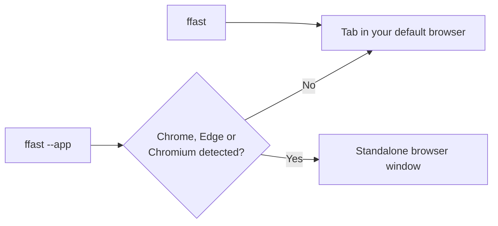
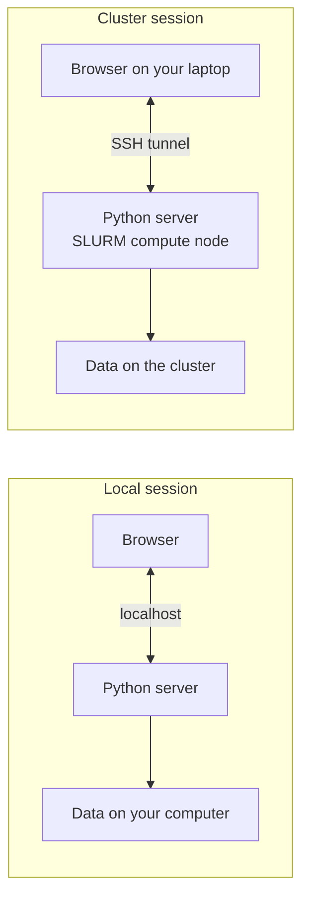

# Installation and launch options

[README](../README.md) · [Documentation](README.md) · [Using FFAST](usage.md) · [LAMMPS](lammps.md)

FFAST currently requires **Python 3.11** (`requires-python = "==3.11.*"` in
[pyproject.toml](../pyproject.toml)). The base install provides the browser
client, server and CLI. It needs no native Qt/OpenGL libraries or JavaScript
build step.

## Install from source

```bash
git clone https://github.com/TCPUniLU/FFAST.git
cd FFAST
```

**With [uv](https://docs.astral.sh/uv/getting-started/installation/):**

```bash
uv venv --python 3.11
source .venv/bin/activate
uv pip install -e .
```

uv installs Python 3.11 if needed; your system Python can use another version.

**With pip and Python 3.11:**

```bash
python3.11 -m venv .venv
source .venv/bin/activate
python -m pip install -e .
```

On Windows, activate either environment in PowerShell with:

```powershell
.\.venv\Scripts\Activate.ps1
```

Check the installation, then launch:

```bash
ffast-cli metrics list
ffast
```

A [Pixi environment](../pixi.toml) and [conda recipe](../recipe/meta.yaml) are
also included. For Pixi, run `pixi install`, then `pixi run ffast`.

## Optional dependencies

Run installation commands from the FFAST checkout with its environment active.
If using pip, replace `uv pip install` below with `python -m pip install`.

| Task | Install |
| --- | --- |
| LAMMPS scoring and reference fitting | Compatible DetectAna checkout and RDKit; follow the [LAMMPS setup](lammps.md#installation) |
| Development and tests | `uv pip install -e ".[dev,live]"`; see [Contributing](../CONTRIBUTING.md) for the fast parser and browser test requirements |

Precomputed predictions need no model-backend extra. Dependencies for optional
inference backends are declared in [pyproject.toml](../pyproject.toml).

### The fast .xyz reader

`.xyz` and `.extxyz` files load up to 10× faster with the fast reader
(`ffast-xyz`, written in Rust). It is not on PyPI. Install it with

```bash
ffast install-fast-reader
```

The command downloads the ready-made reader for your computer from the
[GitHub releases](https://github.com/TCPUniLU/FFAST/releases) (tags
`ffast-xyz-v…`), checks it against the release's `SHA256SUMS`, and installs it
into the Python that runs FFAST. When there is none for your computer, or no
internet, it builds the reader from this checkout instead, which needs
[Rust](https://rustup.rs): it finds Rust on `PATH`, in `$CARGO_HOME/bin` or in
`~/.cargo/bin`.

On a computer without internet (a cluster node), download the wheel for it
from the release elsewhere, copy it over, and run
`ffast install-fast-reader --wheel <file>`. `--from-source` skips the download.

If none of this works, FFAST still runs and reads these files with the slower
Python parser. Run the command again after updating FFAST if FFAST says the
fast reader is too old.

For a [cluster connection](clusters.md), the browser offers to install the
reader before the first `.xyz` or `.extxyz` dataset or prediction load that
needs it. **Install and load** installs in the FFAST-provisioned server venv,
shows progress, then continues the load. **Load with Python** skips installation;
you can remember that choice per cluster profile. A manually managed server
shows instructions instead. If an old native reader already loaded in the
server cannot be replaced in memory, FFAST asks you to use Python for this load
and start a new server job to activate the installed update.

A new reader release is made by pushing a tag `ffast-xyz-v<version>`, where
`<version>` is the one in `rust/ffast-xyz/Cargo.toml` and in `RELEASE` in
`ffast/readers/install_fast.py`.

## Launch options

`ffast` starts a local server and opens your default browser. `ffast-web` uses
the same browser launcher.

```bash
ffast --workdir /path/to/data         # initial file-browser folder
ffast --app                          # request a standalone browser window
ffast --no-browser                   # start servers and print the URL
ffast --ws-port 8765 --web-port 9000   # choose ports
ffast --trace                        # record clicks, messages and timings
```

`--app` uses Chrome, Edge or Chromium when detected; otherwise it opens a normal
tab in your default browser, including Firefox.



Local servers bind to `127.0.0.1`. Trace files go to `~/.ffast/logs/`. Browser
layout is stored per address and port; the default web port is 8764, with a free
port used if it is occupied.

## Cluster sessions

**File → Connect to Cluster…** uses an SSH/SLURM profile. With `provision: true`
in the profile (the default is `false`), automatic setup builds
a wheel from your checkout, transfers it and provisions a server on a compute
node; configured cluster modules supply scientific dependencies. The browser
connects through an SSH tunnel and browses the server's files. You can reconnect
to a server job that is still running after a dropped connection.



*Python reads the data and computes results in both cases. The browser receives
analysis results and requested structures.*

Follow the [cluster setup reference](clusters.md) for profiles.
For live LAMMPS scoring, automatic setup ships a local editable DetectAna
checkout when available, or fetches the release pinned by FFAST. See
[LAMMPS installation](lammps.md#installation).
