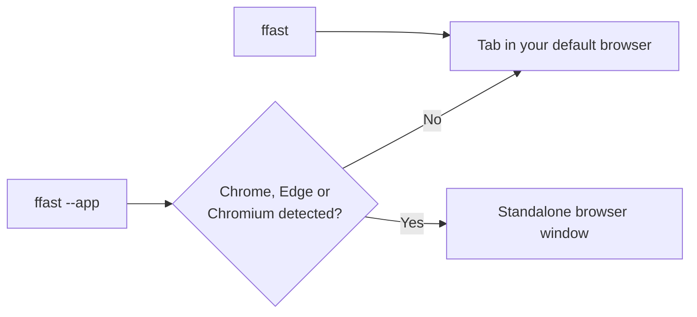
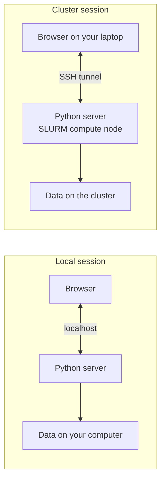

# Installation and launch options

[README](../README.md) · [Documentation](README.md) · [Using FFAST](usage.md) · [LAMMPS](lammps.md)

FFAST currently requires **Python 3.11** (`requires-python = "==3.11.*"` in
[pyproject.toml](../pyproject.toml)). The base install provides the browser
client, server and CLI. It needs no native Qt/OpenGL libraries or JavaScript
build step.

## Install from source

```bash
git clone https://github.com/TCPUniLU/FFAST.git
cd FFAST
```

**With [uv](https://docs.astral.sh/uv/getting-started/installation/):**

```bash
uv venv --python 3.11
source .venv/bin/activate
uv pip install -e .
```

uv installs Python 3.11 if needed; your system Python can use another version.

**With pip and Python 3.11:**

```bash
python3.11 -m venv .venv
source .venv/bin/activate
python -m pip install -e .
```

On Windows, activate either environment in PowerShell with:

```powershell
.\.venv\Scripts\Activate.ps1
```

Check the installation, then launch:

```bash
ffast-cli metrics list
ffast
```

A [Pixi environment](../pixi.toml) and [conda recipe](../recipe/meta.yaml) are
also included. For Pixi, run `pixi install`, then `pixi run ffast`.

## Optional dependencies

Run installation commands from the FFAST checkout with its environment active.
If using pip, replace `uv pip install` below with `python -m pip install`.

| Task | Install |
| --- | --- |
| LAMMPS scoring and reference fitting | Compatible DetectAna checkout and RDKit; follow the [LAMMPS setup](lammps.md#installation) |
| Development | `uv pip install -e ".[dev]"`; see [Contributing](../CONTRIBUTING.md) for test requirements |

Precomputed predictions need no model-backend extra. Dependencies for optional
inference backends are declared in [pyproject.toml](../pyproject.toml).

### The fast .xyz reader

`.xyz` and `.extxyz` files load up to 10× faster with the fast reader
(`ffast-xyz`, written in Rust). It is not on PyPI: build it from this checkout
with

```bash
ffast install-fast-reader
```

This needs [Rust](https://rustup.rs). The command finds it on `PATH`, in
`$CARGO_HOME/bin` or in `~/.cargo/bin`, and installs the reader into the Python
that runs FFAST. Without Rust it says so and changes nothing: FFAST works, and
reads these files with the slower Python parser. Run it again after updating
FFAST if FFAST says the fast reader is too old.

## Launch options

`ffast` starts a local server and opens your default browser. `ffast-web` uses
the same browser launcher.

```bash
ffast --workdir /path/to/data         # initial file-browser folder
ffast --app                          # request a standalone browser window
ffast --no-browser                   # start servers and print the URL
ffast --ws-port 8765 --web-port 9000   # choose ports
ffast --trace                        # record clicks, messages and timings
```

`--app` uses Chrome, Edge or Chromium when detected; otherwise it opens a normal
tab in your default browser, including Firefox.



Local servers bind to `127.0.0.1`. Trace files go to `~/.ffast/logs/`. Browser
layout is stored per address and port; the default web port is 8764, with a free
port used if it is occupied.

## Cluster sessions

**File → Connect to Cluster…** uses an SSH/SLURM profile. Automatic setup builds
a wheel from your checkout, transfers it and provisions a server on a compute
node; configured cluster modules supply scientific dependencies. The browser
connects through an SSH tunnel and browses the server's files. You can reconnect
to a server job that is still running after a dropped connection.



*Python reads the data and computes results in both cases. The browser receives
analysis results and requested structures.*

Follow the [cluster setup reference](clusters.md) for profiles.
Live LAMMPS scoring also needs an editable DetectAna checkout on the laptop
before connecting; see [LAMMPS installation](lammps.md#installation).
