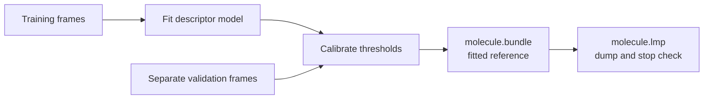
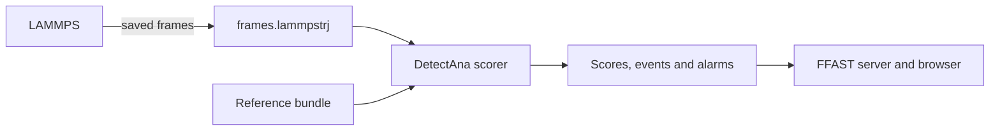
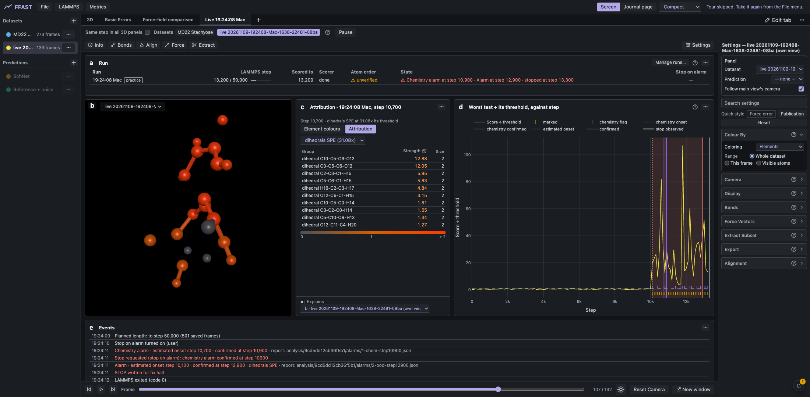
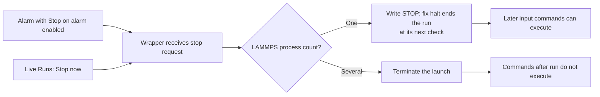

# Using LAMMPS with FFAST

[README](../README.md) · [Installation](installation.md) · [Documentation](README.md)

FFAST reads a running LAMMPS dump and uses a separate DetectAna scorer to compare
structures with a fitted molecular reference. The browser shows geometry,
scores, alarms and attribution, with optional stopping on alarm. These scores
measure structural departure; use reference/prediction comparisons to assess
energy and force accuracy.

> **Experimental.** Live LAMMPS monitoring is new and has been tried on few
> systems and clusters. Commands, file formats and defaults may change. Feedback
> is very welcome: please [open an issue](https://github.com/TCPUniLU/FFAST/issues)
> with what you ran, what you expected and what happened.

[Setup](#installation) · [Tutorial](#try-the-replay-tutorial) ·
[Reference](#make-a-reference) · [SLURM jobs](#submit-a-monitored-slurm-job) ·
[Manual setup](#manual-setup) · [Atom identity](#atom-identity) ·
[Live analysis](#read-the-live-analysis) · [Stopping](#stopping-a-run) ·
[Troubleshooting](#files-and-troubleshooting)

## Supported scope

Live scoring supports **one molecule with fixed atom count and order, no
periodic-boundary handling, and LAMMPS `metal` or `real` units** (coordinates in
ångströms). Multi-partition runs and i-PI beads are unsupported. Ordinary FFAST
dataset analysis has broader support for periodic and variable-sized structures.

LAMMPS needs the generated dump commands, `fix halt` and your force-field pair
style. **Run with FFAST** checks command support. The integration has been tested
with builds dated 23 June 2022 and 2 August 2023. Python runs beside LAMMPS.

## Installation

Install [FFAST](installation.md), activate its Python 3.11 environment, then add
**DetectAna 0.3.0+ with the reference-bundle API** and **RDKit** for bond inference:

```bash
uv pip install -e ".[live]"    # from the FFAST checkout; installs DetectAna 0.4.0 and RDKit
python -c "from ffast.live.detectana_api import require_detectana; print(require_detectana().__version__)"
```

With pip, replace `uv pip install` with `python -m pip install`. Real
simulations also need your own LAMMPS build and force-field packages; the
replay tutorial needs neither.

**For automatic cluster setup**, enable `provision: true` in your
[cluster profile](clusters.md). Bootstrap ships an editable local DetectAna
checkout when available; otherwise it fetches the release pinned in FFAST's
`live` extra and builds its wheel locally. To use a local checkout:

```bash
git clone --branch v0.4.0 https://github.com/AntonCh-G/DetectAna.git ../DetectAna
uv pip install -e ../DetectAna
```

Bootstrap transfers the wheel, installs it and RDKit inside the SLURM job,
and records the scorer environment in `~/.ffast/live.json`. Reconnect to
provision changed dependencies. Fetching the pinned release requires internet
access on the laptop; if it fails, the server starts without live scoring and
reports why. Manually managed servers need the live dependencies in their own
environment.

## Try the replay tutorial

From the FFAST source checkout, run `ffast` and choose
**LAMMPS → Tour: Watch a LAMMPS run** (also in **File**).

1. **Start practice run** replays toy aspirin geometry through the real wrapper
   and scorer. Scores are computed during replay.
2. Follow the prompts: enable **Stop on alarm**, wait for the calm part to
   finish, then choose **Heat it up**. Inspect the alarm, stop and onset frame.
3. Keep or delete the finished run. Kept runs appear in **Live Runs**, marked
   **practice**, under `~/.ffast/practice-runs/`.

This recording has [unverified atom order](#atom-identity). See the
[example notes](../examples/lammps/README.md) for recording and asset details.
The **Run your own LAMMPS** tutorial and local browser launch target are planned;
current browser submission uses SLURM. Local runs use the manual wrapper below.

## Make a reference

Fit on **training frames** and calibrate thresholds on **separate validation
frames**. Both sets must contain the same atoms in the same order, with
coordinates in ångströms. Energies, forces and predictions are unnecessary.
FFAST rejects identical sets and references whose own frames trigger broken-bond
or close-contact checks.



Load both datasets and choose **LAMMPS → Make Reference…**, then select the
sets, name and server output folder. Alternatively, specify atom-type order
with the CLI:

```bash
mkdir -p "$HOME/ffast-references"
ffast bundle \
  --train /path/to/train.extxyz --valid /path/to/valid.extxyz \
  --elements "C H O" --every 100 \
  -o "$HOME/ffast-references/molecule"
```

This writes `molecule.bundle/` (fitted state, thresholds and topology) and
`molecule.lmp` (LAMMPS include). `C H O` means types 1, 2 and 3 respectively;
match this order to the input and force-field mapping. The browser uses each
element's first appearance in the reference as type order.

The include stores an absolute bundle path. Generate it on the run's server or
regenerate it after moving the bundle. Keep bundle, include, input, data and run-folder
paths free of whitespace.

## Submit a monitored SLURM job

[Connect to the cluster](clusters.md). The reference, input,
job script and force-field files must be accessible on the server. Open
**LAMMPS → Run with FFAST…**:

1. **Choose** the job-script folder and reference. Check the discovered input
   and launch. By default, FFAST writes new starting data from the reference
   geometry; you can choose a structure-file frame or retain the existing data.
   Choose whether to stop on alarm.
2. **Check** loads the job's modules, tests the required LAMMPS commands and pair
   style, and checks input placement. Refusals name the line and manual edit.
3. **Review** the diffs for copies such as `run.ffast.in`, `job.ffast.sh` and
   `molecule.ffast.data`. Check geometry and atom-type mapping. Copies go beside
   the originals; only files carrying FFAST's marker can be replaced.
4. Choose submission from **this computer (SSH)** with a cluster profile, or
   **the server's node**, then **Write copies and submit**. FFAST follows the
   queue and opens the live tab after the first frame.

Original files are preserved. For minimisation before MD, FFAST adds a starting
snapshot after atom creation and monitoring before the first `run`, preserving
atom-order proof. Ambiguous scripts, including `clear`, loops, multiple data
reads and some later atom changes, require the manual edits named by Check.

## Manual setup

### Write starting data in reference order

On the scorer's machine/account:

```bash
ffast lammps data \
  --from /path/to/train.extxyz --index 0 \
  --bundle "$HOME/ffast-references/molecule.bundle" \
  --elements "C H O" -o /path/to/run/molecule.ffast.data
```

Use this file in `read_data`. It uses `atom_style atomic`, without charges or
bonded force-field topology. FFAST records its coordinates and bundle identity
under `~/.ffast/lammps-data/` to prove [atom identity](#atom-identity).

### Add the include to the input

Place the include after atom creation and before the first run. Optional
settings go before it:

```lammps
variable ffast_every index 100
variable ffast_persist_ps index 5.0
variable ffast_stop_on_alarm index 0
include /absolute/path/to/ffast-references/molecule.lmp
```

| Setting | Meaning and default |
| --- | --- |
| `ffast_every` | Dump and stop-check interval: 100 steps |
| `ffast_persist_ps` | Statistical-alarm persistence: 5 ps, including with `units real` |
| `ffast_stop_on_alarm` | 0: monitor only; 1: stop on alarm |

Keep your system's unit, boundary, force-field and integration settings. If
minimisation changes coordinates before monitoring starts, use the browser's
generated starting snapshot to preserve the exact coordinate proof.

### Wrap the launch

In a SLURM job, use the wrapper installed by bootstrap:

```bash
~/.ffast/bin/ffast-lammps srun lmp -in run.in
```

For a local run with the FFAST environment active:

```bash
ffast-lammps lmp -in run.in
```

The wrapper starts a single-threaded scorer, enables monitoring and prints a
fresh run folder under `./ffast-runs/` (`FFAST_RUN_DIR` overrides this). Allow CPU
time for the scorer. Without the wrapper, the include reports monitoring off.

Open **LAMMPS → Live Runs…** on a server that can read the folder. Registered
runs appear automatically; **Open run folder…** accepts another folder by path.



*The wrapper starts LAMMPS and the scorer as separate processes. The viewer reads
their recorded output. The [stop flow](#stopping-a-run) is separate from this
data flow.*

## Atom identity

A matching formula cannot prove that repeated elements occupy the reference's
atom order. FFAST reports:

| State | Meaning |
| --- | --- |
| **Proven** | Starting coordinates exactly match FFAST-generated data recorded locally for this bundle, or the generated pre-minimisation snapshot proves the match. |
| **Unverified** | No matching record exists. A passing first-frame bond check allows scoring but cannot prove order. |
| **Refused** | An unverified first frame fails the bond check: atom order may differ, or the geometry is already damaged. |

For a new run, generate data with **Run with FFAST** or `ffast lammps data` on
the scorer's machine/account, preserve its local records and avoid reordering
atoms. Copying only the data file from a laptop omits the proof record. New data
does not retroactively verify an old recording.

## Read the live analysis



*Replay at the chemistry onset. The practice label and unverified atom-order
warning describe this recording.*

- **Run:** LAMMPS progress, scored-through progress and scorer heartbeat are
  separate. The tab starts pinned to its run.
- **3D:** follows the newest frame. Selecting an older frame holds it; returning
  to the newest resumes following. Click a score point or alarm marker to inspect it.
- **Scores:** the worst active test's **score ÷ threshold**, with a threshold
  line at **1**. A single exceedance is a mark; statistical alarms require
  persistence. Chemistry alarms use three consecutive flagged frames.
- **Events:** distinguish estimated onset, confirmation, stop request and
  observed stop. Scoring lag and dump intervals can separate these moments.
- **Attribution:** ranks descriptor groups for the selected test and colours the
  panel chosen under **Explains**. Strengths overlap and do not sum to a total.
  Non-alarm explanations need the bundle and compatible DetectAna; alarm reports
  retain their recorded explanation.

Use **Run scores** in custom timeline or density panels for individual test
ratios, the worst ratio and chemistry counts. Missing scores remain gaps; the
viewer never computes replacements. It currently reads the first analysis in
each run folder.

Select several runs to compare them; **Same step in all 3D panels** uses the
nearest simulation step. **Pause** freezes a tab's plots and frame ranges while
Run and Events update. The simulation, scorer and automatic stopping continue.

## Scoring any trajectory

A trajectory from another program (i-PI, ASE, CP2K, a converted LAMMPS run) can
be scored too. Load it, open the dataset's **⋯** menu and choose **Score against
reference…**. A live run can be scored the same way, from the frames read so far.

The dialog asks for:

- **Reference:** a recorded one, or a `.bundle` folder chosen with **Browse…**.
- **Time between frames (fs):** filled in from the file's `time` field when every
  frame has one and the steps are equal. extxyz has no standard time unit, so FFAST
  takes it as femtoseconds: check it. Leave it empty if the file has no time:
  frames are then marked, but no alarm is raised.
- **Persistence (ps):** as for a live run, 5 ps by default.

The result is a **scored item**: a new entry under the dataset in the list. It
fills in frame by frame, opens a **Scores** tab like a live run's, and works like a
run in that tab: score timeline, events, alarms, attribution, and comparison by
ticking two items (for example, the same file with two persistence values). Nothing
is stopped and there are no Stop controls. Energies, forces and errors of the item
are the dataset's own and are not computed twice.

Limits:

- The reference decides which frames it can score (it is asked about every frame).
  A frame it refuses is a gap in the curve, with the reference's own words under the
  plot. If it can score no frame, the item says so.
- A file with a unit cell is refused: FFAST does not score periodic systems yet.
- The order of atoms in a file cannot be proven. A first frame that fails the bond
  check refuses the item.
- Alarms need a time between frames.

Scores are saved in `~/.ffast/analyses/` (set `FFAST_ANALYSES` to move them), by the
file's content, the reference and the settings. Load the same file in a later
session and its scored items come back. **Cancel** keeps the frames scored so far;
the item's menu then offers **Continue scoring**. **Remove…** hides an item; its
scores stay saved and come back if you score again with the same settings.

## Stopping a run

**Stop on alarm** is off by default; change it in the Run panel. For a manual
request, use **LAMMPS → Live Runs… → Stop now…** for the intended run.



FFAST writes no checkpoint; configure LAMMPS restart output if needed. Check the
observed stop and end state, since a request does not mean LAMMPS has stopped.
After exit, the wrapper gives the scorer time to finish reading saved frames.

## Files and troubleshooting

Each launch creates a new run directory:

| File | Contents |
| --- | --- |
| `frames.lammpstrj` | Geometry, atom IDs, step, time and units |
| `log.lammps` | LAMMPS log, unless another log path was selected |
| `run.json`, `events.jsonl` | Run state, progress, alarms and stop events |
| `scorer.log` | Scorer diagnostics |
| `analysis/<id>/settings.json` | Bundle and analysis settings |
| `analysis/<id>/scores.jsonl` | Scored frames |
| `analysis/<id>/progress.json` | Scorer progress and heartbeat |
| `analysis/<id>/alarms/` | Permanent alarm reports |

Keep the run folder and bundle for later inspection. Scores are separate from
geometry and are not included in exported frames. Live tabs are not saved in
sessions; **Live Runs** finds folders through `~/.ffast/live-runs/` pointers.

| Problem | Check |
| --- | --- |
| Missing DetectAna or bundle API | Install the live dependencies in the scorer environment. For automatic setup, check the DetectAna fetch/build message or install an editable local checkout, then reconnect with `provision: true`. |
| Missing tutorial assets | Run from the source checkout containing `examples/lammps/`. |
| No frames | Check the include, wrapper, accessible paths without whitespace and LAMMPS log. |
| Scoring stalls | Compare LAMMPS progress, **Scored to** and heartbeat; read `scorer.log` and check the bundle path. |
| Unverified atom order | Follow [Atom identity](#atom-identity). |
| Input rejected | Follow Check's named line and hand-edit advice; verify modules and type mapping. |
| Pause leaves the simulation running | Use **Live Runs → Stop now…** to request a stop. |

Implementation: [ADR 0086](adr/0086-lammps-runs-are-watched-live-through-a-dump-and-a-wrapper.md),
[ADR 0087](adr/0087-a-live-run-keeps-scores-apart-from-geometry.md),
[ADR 0091](adr/0091-a-live-runs-scores-are-analysis-values-read-with-gaps-never-filled.md).
