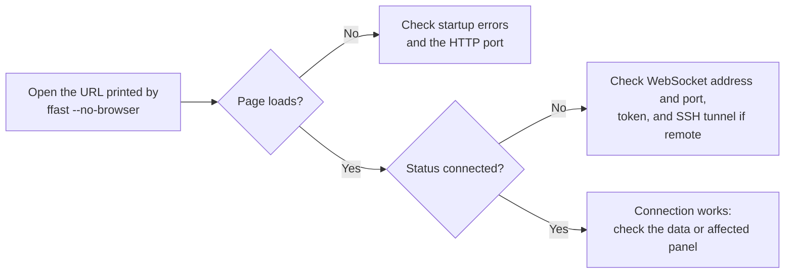

# Troubleshooting

For browser connection problems, start here:



## Install and launch

**Wrong Python.** FFAST pins 3.11 (`requires-python = "==3.11.*"`). If pip
resolved something odd or an import fails in a way that makes no sense, check
`python -V` first.

**`command not found: ffast`, or FFAST does not start.** Console
scripts are written at install time, not read from `pyproject.toml` at run time,
so an editable install made before the entry points changed keeps the old ones.
Check what your environment actually has:

```bash
python -c "from importlib.metadata import entry_points
print([f'{e.name} -> {e.value}' for e in entry_points(group='console_scripts') if 'ffast' in e.name])"
```

`ffast` should point to `launcher:main`; the browser, server and CLI commands
include `ffast-web`, `ffast-server` and `ffast-cli`. If commands are missing or
stale, reinstall from the checkout: `uv pip install -e . --no-deps` (or
`python -m pip install -e . --no-deps` with pip).

**The browser tab opens but stays disconnected.** The web page and the server are
two ports. Run `ffast --no-browser`, read the URL it prints, and open that; if the
page loads but the status stays "Disconnected", the WebSocket port is the
problem, not the page. Pin both with `--ws-port` and `--web-port` and check
nothing else holds them.

**Blank page, or a page with no styling.** This means the static assets did not
ship with the install. It was a real packaging bug once. Reinstall, and if it
persists check that `ffast/renderers/web/static/` exists inside your site-packages
copy of the package.

**Anything involving a synced folder.** Do not install into a virtualenv that
lives in iCloud Drive, Dropbox or OneDrive. The sync client deletes and rewrites
environment files while the app is running. Move the venv out and reinstall.

## Data

**"Cannot load dataset".** Check the format is actually supported. For `.npz`,
confirm it has `R`, `E`, `F`, `z`. For ASE formats, confirm ASE itself can read
it: `python -c "import ase.io; ase.io.read('file')"`.

**"Fingerprint mismatch" when loading predictions.** The dataset file is not the
one the predictions were computed against. Byte-for-byte, not "the same
molecule". Regenerate the predictions or find the original file.

**Models with hash names appear in the sidebar.** Those are ghost models,
reconstructed from cached predictions when the original model file was not
available. They work for everything already computed and cannot compute anything
new. Delete them if you do not want them.

**Axes show `[unit]`.** No unit has been named for those values. Click the axis
unit or table unit header to enter it. Labels do not convert numbers. See
[units and plot labels](usage.md#units-and-editing-labels-by-hand).

**Error plots say there is no data.** Both a dataset and a prediction have to be
selected, and the computation has to have finished. Watch the task list.

**A metric silently produces nothing.** Run `ffast-cli metrics validate`. It
compiles the whole graph and reports bad references, shape mismatches and cycles,
which is faster than inferring the problem from an empty panel.

## Performance

**Predictions take forever.** They are cached by content fingerprint, so you pay
once. For anything large, compute them on the machine that has the GPU and load
the resulting file.

**The 3D view is slow.** Turn off bonds or force vectors, shrink atoms, or make a
subset. Dynamic bond detection is the expensive part on big systems.

**Large trajectories over a cluster connection.** Load with a stride. The dialog
offers one when the file is long. Then extract the subset you actually care about
and inspect that locally.

## Still stuck

Read the server terminal, the browser console, or the trace produced by
`ffast --trace`. Include the relevant error and reproduction steps in an issue.
