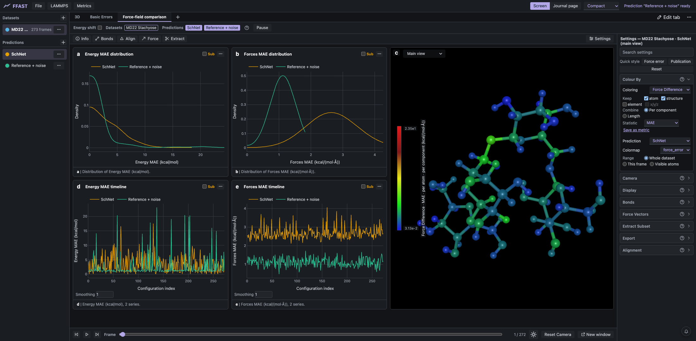
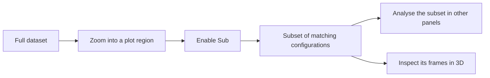

# Using FFAST

Reference for day-to-day use. If you just want to see it work, the quick start in
the [README](../README.md) is shorter.

[Installation and launch options](installation.md) · [Documentation index](README.md)

For live simulations, see the [LAMMPS guide](lammps.md): dependency setup,
reference fitting, monitored jobs, the replay tutorial, alarms and stopping.

- [The interface](#the-interface)
- [Loading data](#loading-data)
- [Example data](#example-data)
- [Analysis tabs](#analysis-tabs)
- [The 3D view](#the-3d-view)
- [Subsets](#subsets)
- [Sessions](#sessions)
- [The command line](#the-command-line)
- [More guides](#more-guides): clusters, custom metrics, scripting

## The interface

The browser client is the main interface. The instructions below describe it.
Run `ffast` to start a local server and open the browser; `ffast-web` is an alias.

```bash
ffast                   # local server plus a browser tab
ffast --app             # request a standalone browser window
ffast --no-browser      # start servers and print the URL
ffast --ws-port 8765 --web-port 9000    # choose ports
ffast --trace           # record clicks, messages and timings
```

`--app` uses Chrome, Edge or Chromium when detected, otherwise your default
browser opens a normal tab. See [launch options](installation.md#launch-options).

With `--trace` the server writes one file per run,
`~/.ffast/logs/trace-<date-time>.log`, and keeps the last 10. It lists, in
order, what you clicked, changed or pressed, each command the page sent, how
long the server took to run it (or the error and traceback when it failed),
each reply, and every error or warning in the page. Reproduce the problem, then
read the file from the end, or send it with the bug report. Large data is
shortened to its size, so the file stays small. `ffast-server --trace DIR`
writes to `DIR` instead.

For slow large-file loading or metric computation, use the opt-in
[performance profiler](performance-profiling.md) to record loading phases,
CPU/RAM samples and first-versus-repeated Basic Errors requests.

The page is served on port 8764, so the browser remembers its layout (open
settings section, sidebar width, recent servers) from one launch to the next;
the browser keeps these per address, port included. If 8764 is taken, for
example by a second `ffast-web`, that window gets a free port and starts with
the default layout.

Local servers bind to `127.0.0.1`. The browser client needs no native Qt or
OpenGL libraries.

The browser interface:



*Left: loaded data and predictions. Centre: the active tab's plots and 3D view.
Right: settings for the focused 3D panel. This example uses a custom layout.*

- **Top bar.** Server address, optional session token, a read-only toggle,
  Connect / Disconnect, and Save / Load Session. Launching with `ffast-web`
  fills the address in and connects for you.
- **Left rail.** Datasets and Predictions, each with a `+` to load one. Datasets
  also get a download button that exports the current selection as extxyz.
- **Own views.** A 3D panel can show its own data next to the main view:
  pick a dataset or subset in the drop-down in its top-left corner, and it
  becomes an **own view** at once; pick "Main view" to link it back. Either
  saves the tab, as Edit mode's ⚙ → "Own view" does. The last panel showing
  the main view stays on it, and its drop-down says so. Click a panel to focus
  it; the top of the settings sidebar then picks an own view's prediction and
  whether its frame and camera follow the main view. Following, one Play or orbit moves both panels; unticked,
  you can compare two frames of one trajectory. When the main view's frame
  has no counterpart in the panel's data, the panel greys out and says so.
  "Use current 3D settings as start" saves the panel's look with the tab.
- **Tabs.** Each tab is a grid of panels: the built-in "3D" tab (one 3D panel
  filling it), the analysis tabs, your project's tabs and your own. A tab may
  put a 3D panel beside plots. The ⋯ at the end of the tab bar exports the tab
  on screen as TOML for a project's `ffast.toml`, resets an edited built-in or
  project tab to the original, hides a tab, and shows hidden ones again.
  Your own tabs are saved on the server's machine, one TOML file per tab in
  `~/.ffast/tabs/` (`ffast-server --tabs-dir` chooses another folder).
- **Right sidebar.** Settings for the focused 3D panel: Colour By, Camera,
  Display, Bonds, Force Vectors, Extract Subset, Export and Alignment.
- **Warnings and errors** appear as pop-ups in the bottom-right corner:
  yellow for a warning (the work was done, but something is left out or
  doubtful), red for an error (something you asked for did not happen). A
  pop-up closes by its × or by itself after 10 seconds, and stays while the
  pointer is on it. The same message again adds "×2" to the open pop-up. A
  panel's warning or failure pops up once, not on every redraw. The pop-up
  is extra: the ⚠ beside a panel's title, a failed panel's "Could not compute
  ‹metric›: ‹reason›", a warning under a formula and an error on the status
  line stay where they are. An error that answers a button you pressed in a
  pane (such as "x is not an input") shows only next to that button.

Select a dataset to inspect it. Error analysis also needs a prediction. For
browser development, see [Contributing](../CONTRIBUTING.md).

## Loading data

### Datasets

Two families of format:

**sGDML `.npz`**, with keys `R` (positions, shape `(N, n_atoms, 3)`), `E`
(energies, `(N,)`), `F` (forces, `(N, n_atoms, 3)`) and `z` (atomic numbers,
`(n_atoms,)`). Lattice vectors are read if present.

**Anything ASE can read**: `.extxyz`, `.xyz`, `.traj`, `.db` and the rest.
Energies come from `atoms.info['energy']` or `get_potential_energy()`, forces
from `atoms.arrays['forces']` or `get_forces()`. Datasets whose configurations
have different atom counts are detected and handled; you do not have to say so.

**Any other format**, through a *reader*: a small Python package that turns the
file into arrays. Its name appears in the dialog's Type list. See
[Writing a reader](writing-a-reader.md).

After loading, the rail shows the configuration count, atom count (a range for
variable-sized data), chemical formula, and the fingerprint. The fingerprint is
an MD5 of the contents and is what the cache keys on, so the same file loaded
twice costs nothing the second time.


*Select the file, choose which frames to load if needed (here a sample by
energy, below), name its stored units, then Load. Energy and force columns are
selected automatically when unambiguous; otherwise the dialog asks which
columns to use. Naming units does not convert values.*

### Large XYZ files

For `.xyz` and `.extxyz`, **Memory ▸ Automatic** keeps parsed arrays in RAM
when they fit, and switches to memory-saving storage for larger datasets.
Choose **Save memory** to force that mode. All selected frames remain available;
this setting does not sample the dataset. The optional Rust parser is used in
both modes.

Memory-saving storage keeps the frame index and a bounded cache. An uncached
molecule is read from its byte range in the original file. An optional parsed
disk cache makes repeated access faster; a full or unwritable cache falls back
to the source file. The first open still scans the data for its fingerprint.
Keep the source unchanged while it is open; a changed file requires a reload.
Predictions from columns in that same file reuse the scanned columns and
fingerprints, including when loaded later through the prediction dialog.

Large full-file XYZ loads can index and parse bounded windows concurrently
with the optional fast parser. Small, frequently reused scalar columns stay
in the shared RAM budget. If disk space cannot hold all parsed fields, the
cache keeps per-frame values, cell and species first, then forces, then
positions; anything left out is read from the source file. Saved batch boundaries stay valid when available RAM changes.

Basic Errors shares a batched force-summary pass between compatible MAE/RMSE,
per-structure errors and outlier requests. Force parity counts use a second
pass; timelines and distributions reuse the saved per-structure errors.
Up to four batches can read and calculate concurrently, reduced when CPU or
RAM headroom is smaller. Results are merged in source order.
Several requested results can therefore appear in Tasks while sharing work.

Built-in analyses, prediction batches and XYZ export process bounded batches.
Large results can spill to disk. An operation that cannot fit its working data
or result is refused while the dataset stays open. External metrics and model
implementations still need to respect their input and working-memory limits.
Downloading a whole metric through the existing bulk CSV/RPC interface can
require that result to fit RAM; plot previews are thinned in batches.

Set server-wide limits in `ffast.toml` before starting the server, in bytes:

```toml
[resources]
ram_bytes = 4294967296          # 4 GiB shared by datasets, caches and active work
parsed_cache_bytes = 21474836480 # 20 GiB; 0 disables parsed disk caching
result_cache_bytes = 21474836480 # 20 GiB; 0 disables result spill
```

Without overrides, RAM admission uses 80% of available laptop memory, or 85%
of remaining cgroup/Slurm memory, leaving at least 512 MiB of headroom when
available. These limits account for managed arrays and work reservations;
Python, model libraries and index metadata also consume process memory.
The automatic RAM cap is chosen when the budget is created; it does not grow
when another application exits. New allocations also check current free
memory, and cached batches can be evicted under pressure.
Leave extra room for external model workspaces. If a Slurm job's allocation
is not visible (for example `--mem=0` whole-node jobs), FFAST uses 80% of the
node's free memory and logs a warning; set `FFAST_MEMORY_BYTES` on a shared
node.

Environment equivalents are `FFAST_MEMORY_BYTES`, `FFAST_PARSED_CACHE_BYTES`
and `FFAST_RESULT_CACHE_BYTES`; explicit project settings take precedence.
Parsed data defaults to `~/.ffast/frame-arrays` (`FFAST_FRAME_ARRAYS_DIR`);
result files default to its `results` folder (`FFAST_RESULT_CACHE_DIR`). Use
disk storage for result spill. Both disk budgets default to 20 GiB; available
disk space can impose a smaller limit.

The CLI accepts `ffast-cli metrics run … --memory-mode saving`. Other formats
retain their current readers; this does not add HDF5 or TensorFlow Datasets
support.

### Loading a sample by energy

A long trajectory holds many similar low-energy frames and few high-energy
ones, and the rare high-energy frames are where a force field most often fails.
**Frames ▸ Every Nth** keeps that mix. **Frames ▸ Sample by energy** keeps N
frames spread over the whole energy range instead, and reads positions and
forces for those N only, so it also works for a file too big to load whole.

When you choose it, FFAST reads every frame's energy once (seconds to a minute
for millions of frames; it remembers them for the next time) and shows a
histogram: all frames in grey, the frames it would keep in colour. The
histogram follows the fields as you change them:

- **Method.** *Even across energies* (the default) takes about the same number
  of frames from each energy bin, so the rare high-energy frames are not
  drowned out. Use it to look at, or test a model on, the whole energy range.
  *Keep the energy distribution* takes from each bin in proportion to its size,
  so the sample looks like the file. Use it when the sample should represent
  the data, for example a training set. Every bin that has frames keeps at
  least one either way.
- **Frames to keep** (N). You get exactly N, or every frame with an energy if
  the file has fewer.
- **Bins.** Empty means automatic: it follows how wide the energies spread and
  how many frames you keep. The number used is shown in the field.
- **Seed.** Inside a bin, frames are picked at random. The same seed on the same
  file picks the same frames; another seed picks others, with the same number
  per bin.
- **Energy.** Which energy to bin by; it starts on the reference energy. When
  the frames have different atom counts, FFAST bins the energy per atom, since
  total energies of different-sized structures are not comparable. The
  histogram's axis says which.

Frames with no energy are left out of the sample, and FFAST says how many.

A sampled dataset remembers which frames it kept. A prediction you load for it
reads exactly those frames from its own file, which must have as many frames as
the dataset's file. A saved session stores the list and loads the same frames
again; it does not sample anew. The dataset's Info says how it was made, for
example "5,000 of 1,200,000 frames, sampled by energy (even, seed 42)".

Sampling by energy needs a reader that lists each frame's energy: `.xyz` and
`.extxyz` files have one, and so can any reader you write
([Writing a reader](writing-a-reader.md)). For other files the option is
greyed out.

### Predictions

The normal path is a file of pre-computed energies and forces:

- **`.npz`** with `E` shaped `(N,)` and `F` shaped `(N, n_atoms, 3)`.
- **ASE-readable** files carrying energies and forces the same way a dataset
  does.

Load one (File > Load Prediction, or `+` in the browser's Predictions list) and
pick the dataset it belongs to.
Before a prediction attaches, FFAST checks it against its dataset. It **refuses**,
and says what differs, when the number of frames is different, when a frame has
a different number of atoms, or when an atom is a different element. It
**warns** and loads when positions differ by more than 0.001 Å (files often
round positions) or when the unit labels differ; FFAST never converts units. It
cannot tell two trajectories apart that have the same elements in the same
order, so make sure the file really belongs to the dataset.

There is also a zero model, which predicts zero for everything. It sounds silly
and is genuinely useful: it turns every error plot into a plot of the dataset's
own magnitudes, which is how you spot a corrupted trajectory or a unit mismatch
in about five seconds.

For most workflows, generate predictions where you trained the model and load
the resulting file.

## Example data

`examples/data/` contains MD22 molecules, a random 100-configuration SPICE
sample and periodic MPtrj structures, with matching
predictions. **Load Example** opens the SPICE pair in
`examples/data/variable-sized molecular/`. Paths with spaces must be quoted
in shell commands.

AM26 remains on `dev` pending redistribution permission; graphene is deferred
until its source units have been established and its pair uses matching units.
[examples/data/README.md](../examples/data/README.md) documents each source,
sampling method, permission and units. Published pairs load correctly with
default energy and force selection; controls are labelled "reference + noise".

`examples/MACE/` and `examples/Nequip/` are saved sessions rather than raw data;
open them with Load Session.

## Analysis tabs

Four ship built in. All four are TOML files in `ffast/config/builtin_tabs/`, with
no special status compared to ones you write.

**Basic Errors.** Energy and force MAE/RMSE along the trajectory, KDE
distributions of the errors, true-versus-predicted scatter for both, and summary
tables. The "subtract mean energy offset" toggle removes the constant energy bias
(mean of predicted minus true) everywhere at once; affected plots retitle
themselves "(shifted)" so you cannot forget it is on.

**Atomic Errors.** Force error distributions and tables per element, with an
element picker. This is where "the model is fine except on hydrogens" shows up.

**Subsystem Errors.** Net per-structure force error, distribution plus tables.

**Gyration.** Radius of gyration (weighted by atomic number) over the trajectory
and its distribution, overlaid against energy and force error, with a shared
smoothing control. Useful for asking whether the model gets worse when the
molecule is extended.

Each tab has its own dataset and prediction selector, and you can select several
predictions at once to compare them in one panel.

### Units, and editing labels by hand

FFAST reads stored values; naming a unit does not convert them. An energy or
force axis shows `[unit]` until you name its unit. Click the axis unit or a
table's unit header, enter the unit, and press Enter. The server applies it
to the datasets shown in that panel and shares it with other windows.

For cosmetic changes, open a plot's **⋯ → Edit labels…** to change titles,
text sizes and legend placement. **Reset labels** restores the defaults.
These edits are saved with the tab and do not change the metric calculation.

## The 3D view

Left-drag rotates, right-drag pans, scroll zooms, also while a pick tool
(Info, Force, Extract, ...) is on: a click picks an atom, and Shift+drag draws
a box with Force or Extract. The strip under the viewport
steps through frames, plays them at a set frame rate and optionally skips
frames. **New window** opens a separate browser view.

Clicking uses whichever pick tool is armed in the toolbar:

| Tool | What it does |
|------|--------------|
| Info | Click 1 to 4 atoms: position, then distance, then angle, then dihedral |
| Bonds | Pick two atoms to add or remove a bond |
| Align | Pick three atoms to define a reference frame |
| Force | Select atoms (including by rubber-band) to restrict force arrows to |
| Extract | Select atoms to carve out a subset |

The sidebar panes:

- **Display** — atom size, index labels, index and element filters (`0 1 2`, `C`,
  or `-H` to exclude) and highlighting.
- **Bonds** — show or hide, width, dynamic detection with an adjustable cutoff
  leniency, or fixed bonds.
- **Colour By** — elements, displacement, or any per-atom or per-element metric
  such as force error, with a choice of colormap and a colourbar. The metric is
  scanned in batches for its exact minimum and maximum, so the colourbar's
  range covers every frame and a colour means the same error in each frame.
  3D colouring caches that range and calculates values for the visible frame;
  it does not save a colour array for the whole trajectory. Changing frames
  reuses the range. The first calculation still reads all relevant values.
  Type a minimum or maximum to fix the range yourself. With a prediction that
  covers only the frame on screen, the colouring uses that frame and the
  colourbar says "this frame". Metric parameters appear under the picker when
  the chosen metric has any. **Prediction** says whose numbers: for
  **Forces**, Ground Truth colours by the dataset's own forces and a model by
  its predicted forces, and Combine picks the length ("Forces · Magnitude") or
  per component; an error such as Force Difference needs a model, so it offers
  no Ground Truth; a metric of the dataset alone hides Prediction.
  The colourbar on the 3D view is four pieces: the bar, its name, and the
  highest and lowest value. Drag any of them; they snap into line with each
  other, with a guide. Shift-click to select several; right-click a piece to
  turn it 90°, group the selection (a group moves and turns together), switch
  the whole bar between upright and lying ("Rotate all 90°"), or reset it.
  A selected piece shows a grip in its corner: drag it to resize the piece (a
  text's font grows with it), or press + and -. One arrangement
  serves every colouring, is kept in this browser, and an exported PNG shows
  the pieces where they are on screen.
- **Force Vectors** — arrow length, normalised or true length, restricted to a
  selection or not.
- **Camera** — position and target, field of view, centre-of-mass tracking, saved
  positions, orientation axes. Dragging turns the view freely, over the top
  and round again, and can tilt it; "Exact angles" shows azimuth, elevation,
  roll (the tilt about the line of sight) and distance. The XY, XZ and YZ
  buttons take the tilt away.
- **Alignment** — Kabsch alignment of every frame onto frame 0 (optionally heavy
  atoms only), or alignment on a three-atom reference frame.
- **Extract Subset** — build a new dataset from selected atoms.
- **Export** — PNG of the current view, optionally with a transparent
  background.

Unit cells are drawn when the data has lattice vectors.

## Subsets

The workflow FFAST is built around: find something odd in a plot, look at it in
3D.



*The source plot keeps the full dataset. The subset follows the selected region
until Sub is disabled.*

1. In an error timeline, zoom to the region you care about.
2. Tick **Sub** on the plot.
3. A new dataset named after the plot appears in the rail, containing exactly
   the configurations in view. The tab's other plots and tables redraw with
   just those configurations, and the 3D view shows them, coloured and drawn
   as the full dataset was. All of it follows further zooming; the plot you
   zoom keeps showing the full data. One plot per tab has **Sub** at a time.
4. Untick **Sub** to hide the subset; the plots and the 3D view go back to
   the full dataset, the 3D view on the same structure.

The same works on a scatter plot (zoom onto the outliers) and on an error
distribution (zoom onto a range of errors: the subset is the configurations
whose error falls in it). On a remote session this is also the mechanism that
keeps data on the cluster: only the subset you asked for crosses the network.

The Extract Subset pane does the same thing along the other axis, selecting atoms
rather than configurations, which is how you get "just the active site" out of a
large system.

## Sessions

Save Session writes a directory containing `info.json` (which datasets and models
were loaded) and `cache/*.npz` (everything computed so far). Load Session
restores it.

Two caveats. The original dataset files must still be where they were, because
sessions store paths rather than copies. And if a model file has gone missing,
FFAST reconstructs a ghost model from the cached predictions: it shows up in the
rail with a hash for a name and works for everything except computing something
new.

## The command line

`ffast-cli` does everything the analysis machinery can do without a UI.

```bash
ffast-cli config validate ffast.toml

ffast-cli metrics list                       # registered metric IDs
ffast-cli metrics inspect <metric_id>        # inputs, parameters, shape, unit
ffast-cli metrics test [<metric_id>]         # run the metrics' own test cases
ffast-cli metrics validate                   # freeze the graph; report bad refs, shapes, cycles

ffast-cli metrics run <metric_id> --dataset data.xyz \
    [--prediction pred.xyz] [--pred-energy-key energy] [--pred-force-key forces] \
    [--param KEY=VALUE ...] [--json]

ffast-cli stages list | inspect <id> | test [<id>]     # 3D scene stages
ffast-cli dataset keys data.xyz                        # which keys are usable as fields
```

All of these honour a project config, discovered automatically or passed with
`--config`, so your own metrics are available to them too.

`metrics validate` is the one worth putting in a script. It compiles the whole
metric graph and fails on a bad reference, a shape mismatch or a cycle, before
you find out by staring at an empty plot.

### Checking a cache or a bundle

By default FFAST trusts a parsed cache when the file's size and modification
time are unchanged, and a bundle when every batch file has the right size.
`ffast-cli cache verify` is the strict check: it reads the source once and
every cached batch once, and compares them with digests stored when the file
was first parsed.

```bash
ffast-cli cache verify so3lr_10GB.xyz                  # the file's parsed cache
ffast-cli cache verify so3lr.ffast/dataset.ffast.json  # a bundle
```

```
so3lr.ffast  (bundle, schema 1)
  batches  411 of 412 verified; 81920-86016.npz: forces differ
  source   not found (looked in /scratch/u/so3lr_10GB.xyz and beside the bundle); not verified
1 mismatch. The bundle was not changed.
```

Each line says what was verified, what differed and what could not be checked.
The exit status is 0 when nothing differed, 1 when something did, and 2 when
nothing could be checked (no finished cache, no stored digests). A parsed cache
that differs is repaired by deleting the bad batch (or, when the source itself
changed, the whole cache of that file); the next load parses it again. A bundle
is never changed. Source digests are recorded only by a scan with the current
`ffast-xyz` (`ffast install-fast-reader`); older caches still get their batches
checked.

## More guides

- [Running on a cluster](clusters.md): SSH/SLURM profiles, remote servers and
  reconnecting.
- [Custom metrics and tabs](custom-metrics.md): dataset fields, formula metrics,
  panels, tabs and metrics in Python.
- [Scripting and configuration](scripting.md): using FFAST from Python without a
  UI, and the configuration files.
- [Writing a reader](writing-a-reader.md): load and export another file format.
